# BÁO CÁO KỸ THUẬT: PHÁT HIỆN VÀ PHÂN LOẠI MÃ ĐỘC TRÊN BỘ NHỚ ĐA KIẾN TRÚC (x32 & x64) VỚI KỸ THUẬT ĐẶC TRƯNG ĐỒNG QUY VÀ MẠNG SINH CÓ ĐIỀU KIỆN (cWGAN-GP)

---

## 1. Đặt vấn đề & Bối cảnh thực nghiệm

Các mô hình học máy phát hiện mã độc qua bộ nhớ RAM huấn luyện trên bộ dữ liệu chuẩn **CIC-MalMem-2022** (thu thập trên môi trường **Windows 7 32-bit / x32**, gồm `58.596` mẫu) đạt độ chính xác rất cao khi kiểm thử nội miền (In-domain Accuracy > 99% ở bài toán nhị phân). Tuy nhiên, khi triển khai kiểm thử thực tế trên **200 bản dump bộ nhớ Windows 10 64-bit (Build 19041)** (`features_all_x64_19041.csv`), hệ thống đối mặt với 3 thách thức kỹ thuật lớn:

1. **Hiện tượng Trôi dạt miền dữ liệu do lệch kiến trúc hệ điều hành (OS & Architecture Domain Shift):**
   - Trên Windows 10 x64, quy mô tài nguyên nền tảng của hệ điều hành lớn hơn gấp nhiều lần so với Windows 7 x32. Ví dụ: đặc trưng `ldrmodules.not_in_load` ở mẫu sạch (Benign) trên x32 chỉ dao động quanh `75.6 ± 14.6`, nhưng trên mẫu sạch Windows 10 x64 vọt lên `417.2 ± 178.7` (cao hơn cả ngưỡng mã độc của x32 là `46.1 ± 7.4`).
   - Hệ quả: Mô hình 55 đặc trưng cũ (`Models_Cleaned`) sụp đổ hoàn toàn trên x64 (XGBoost đoán 100% mẫu là Benign, chỉ đạt **15,00% Accuracy**).
2. **Hạn chế của việc cắt giảm xuống 22 đặc trưng tĩnh (`FEATURES_22`):**
   - Việc loại bỏ 33 đặc trưng hệ thống (`pslist`, `dlllist`, `handles`, `svcscan`, `callbacks`) và chỉ giữ 22 đặc trưng thuộc `ldrmodules`, `malfind`, `psxview` giúp Random Forest phát hiện được mã độc ở Kịch bản 1 (**84,50% Accuracy** trên 200 mẫu x64), nhưng gặp hai nhược điểm chí mạng:
     - **Mất khả năng nhận diện mẫu sạch (Benign) trên x64:** Mô hình có xu hướng gán nhãn Malware cho gần như toàn bộ mẫu x64 (chỉ nhận đúng `2/15` đến `5/30` mẫu Benign, FPR lên tới `43% – 50%`).
     - **Suy giảm thông tin phân biệt họ mã độc (KB2 & KB3):** Khi bỏ 33 đặc trưng, `58.596` mẫu của MalMem2022 bị trùng lặp và co lại chỉ còn `~30.000` mẫu duy nhất, khiến độ chính xác Kịch bản 2 và Kịch bản 3 trên x64 chỉ đạt **15% – 34%** (KB2) và **0% – 10%** (KB3).
3. **Sự xuất hiện của các dòng mã độc thế hệ mới trên x64 (Open-set / New Families):**
   - Tập dữ liệu x64 gồm **30 mẫu Benign** và **170 mẫu Malware** chia thành **17 biến thể thuộc 10 họ mã độc**:
     - *Ransomware (50 mẫu):* `Conti-1`, `Conti-2`, `LockBit-2`, `LockBit-3`, `Pysa-1`.
     - *Spyware (50 mẫu):* `AgentTesla-1`, `AgentTesla-2`, `Formbook-1`, `Formbook-2`, `SnakeKeylogger-3`.
     - *Trojan (70 mẫu):* `DCRat-1`, `QuasarRAT-2`, `QuasarRAT-3`, `Remcos-1`, `Remcos-2`, `Remcos-3`, `TrickBot-2`.
   - Trong 10 họ này, chỉ có `Conti` và `Pysa` từng xuất hiện trong 16 họ của MalMem2022; **8 họ còn lại hoàn toàn mới**. Đồng thời, mỗi biến thể chỉ có 10 mẫu và không có thêm nguồn thu thập mẫu Benign x64 bên ngoài.

---

## 2. Quy trình Phương pháp luận & Các bước triển khai

Để giải quyết đồng thời bài toán **tăng độ chính xác trên cả hai kiến trúc x32 và x64** ở cả **3 kịch bản phân loại**, quy trình 4 giai đoạn sau đã được thiết kế và thực thi:

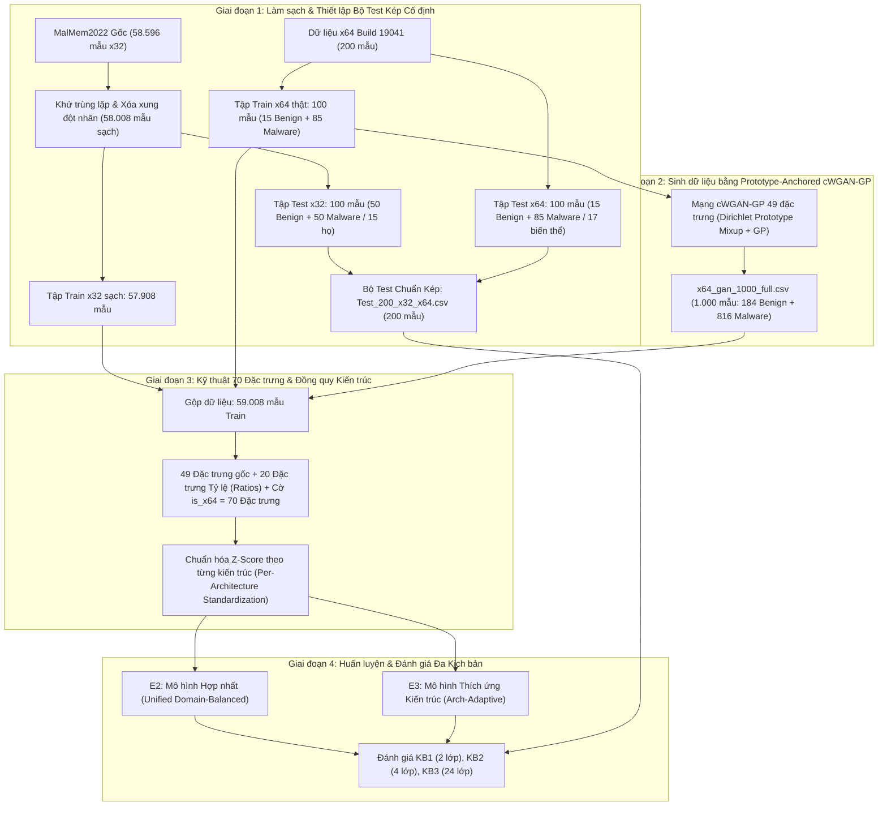

### 2.1. Giai đoạn 1: Làm sạch dữ liệu gốc và Thiết lập Bộ Test Chuẩn Kép (100 x32 + 100 x64)
- **Khử nhiễu & xung đột nhãn trên MalMem2022 (`x32`):**
  - Kiểm tra trên không gian 55 đặc trưng phát hiện `569` bản ghi trùng lặp hoàn toàn và `19` vector đặc trưng mang nhãn mâu thuẫn giữa các họ mã độc.
  - Sau khi loại bỏ hoàn toàn các bản ghi trùng và xung đột nhãn, thu được **`58.008` mẫu x32 sạch tuyệt đối**.
- **Tách bộ kiểm thử chuẩn 200 mẫu (`Test_200_x32_x64.csv`):**
  - **100 mẫu Test x32 (`x32_test_100.csv`):** Tách phân tầng (stratified) theo họ mã độc từ tập sạch, gồm **50 mẫu Benign** và **50 mẫu Malware** (phân bổ đều qua 15 họ mã độc x32). Phần còn lại gồm **`57.908` mẫu** lưu vào `x32_train_clean.csv`.
  - **100 mẫu Test x64 (`x64_test_100.csv`):** Chia 50/50 phân tầng theo `Category` từ 200 mẫu x64 (`random_state=42`), gồm **15 mẫu Benign** và **85 mẫu Malware** (5 mẫu × 17 biến thể). **100 mẫu Train x64** (`x64_train_100.csv`) có phân bố tương đương.
  - Toàn bộ 200 mẫu test được **khóa cố định**, tuyệt đối không tham gia vào quá trình huấn luyện GAN hay tính toán tham số chuẩn hóa.

### 2.2. Giai đoạn 2: Mở rộng tập Train x64 bằng mạng Prototype-Anchored cWGAN-GP đầy đủ đặc trưng
- **Thử nghiệm bước đệm (cWGAN-GP trên 22 đặc trưng):**
  - Ban đầu, mạng Conditional WGAN-GP được thử nghiệm chỉ trên 22 đặc trưng (`gan_augment.py`, sinh 1.000 mẫu lưu tại `x64_gan_1000.csv`). Kết quả cho thấy khi gộp với MalMem2022 (`train_merged_gan.py`), độ chính xác trên x64 ở KB2 tăng từ `15% -> 49%` và KB3 tăng từ `0% -> 38%`, nhưng KB1 vẫn bị lệch sang đoán Malware (chỉ nhận đúng `2–4/15` mẫu Benign) do 22 đặc trưng thiếu thông tin cấu trúc hệ thống.
- **Nâng cấp lên Prototype-Anchored cWGAN-GP trên toàn bộ 49 đặc trưng khả dụng (`prepare_and_gan_full.py`):**
  - Trên dữ liệu x64, ngoại trừ 6 cột `psxview` không khả dụng (toàn NaN), có **49 đặc trưng khả dụng** (gồm 41 đặc trưng biến thiên độc lập, 2 đặc trưng trùng cặp hoàn toàn là `ldrmodules.not_in_mem == ldrmodules.not_in_load` và `not_in_mem_avg == not_in_load_avg`, cùng 6 đặc trưng hằng số).
  - Để khắc phục hiện tượng *Mode Collapse* và *Rò rỉ ranh giới lớp* khi mỗi biến thể chỉ có 5 mẫu thật, kiến trúc **Prototype-Anchored Generator** được thiết kế:
    - Với mỗi mẫu cần sinh thuộc lớp $c$, Generator lấy tổ hợp lồi ngẫu nhiên theo phân phối Dirichlet $w \sim \text{Dir}(\alpha)$ của các mẫu thật thuộc lớp $c$ làm điểm neo nguyên mẫu (anchor), sau đó học biến đổi dư phi tuyến (non-linear residual perturbation) từ nhiễu $z$ và nhãn one-hot $c$ dưới sự dẫn dắt của Critic có phạt đạo hàm **Wasserstein Gradient Penalty ($\lambda_{GP}=10$)**.
    - Sau khi sinh, dữ liệu được biến đổi ngược $\exp(x)-1$, cắt về miền hợp lệ, làm tròn số nguyên cho các cột đếm (count features), và tái tạo chính xác các cột phụ thuộc.
  - **Cân bằng lại tỷ lệ Benign x64 khi sinh:** Vì không có nguồn thu thập thêm mẫu dump Benign bên ngoài, mạng GAN được điều phối sinh **184 mẫu Benign** (gấp ~3,8 lần mỗi biến thể Malware) + **48 mẫu × 17 biến thể Malware** = **1.000 mẫu tổng hợp** (`x64_gan_1000_full.csv`).

#### Bảng kiểm định chất lượng 1.000 mẫu GAN (`GAN_Full_Quality_Report.csv`)
| Chỉ số kiểm định chất lượng dữ liệu sinh | Giá trị đạt được | Ý nghĩa khoa học |
| :--- | :---: | :--- |
| **Số mẫu duy nhất / 1.000 mẫu sinh ra** | **1.000 / 1.000** | Không bị suy biến mode (No Mode Collapse) |
| **Số mẫu sao chép y hệt mẫu thật (Exact Copies)** | **0** | Không học vẹt / không rò rỉ mẫu thật |
| **Khoảng cách trung vị tới mẫu thật gần nhất (Median DCR)** | **0,7997** | Nằm trong đa tạp lớp nhưng giữ khoảng cách đa dạng hợp lý |
| **Thống kê KS trung bình trên 41 đặc trưng biến thiên** | **0,1372** | Phân phối biên bám sát phân phối thực tế |
| **TSTR KB1** *(Chỉ train trên 1.000 mẫu GAN $\rightarrow$ Test trên 100 mẫu x64 thật)* | **89,00%** | Dữ liệu giả mang đầy đủ đặc trưng phân loại nhị phân |
| **TSTR KB2** *(Chỉ train trên 1.000 mẫu GAN $\rightarrow$ Test trên 100 mẫu x64 thật)* | **60,00%** | Bảo toàn tốt cấu trúc 4 nhóm hành vi mã độc |
| **TSTR KB3** *(Chỉ train trên 1.000 mẫu GAN $\rightarrow$ Test trên 100 mẫu x64 thật)* | **46,00%** | Bảo toàn ranh giới chi tiết giữa 18 lớp trên x64 |

### 2.3. Giai đoạn 3: Kỹ thuật 70 Đặc trưng & Chuẩn hóa Đồng quy Kiến trúc (Domain Alignment)
1. **Khôi phục 49 đặc trưng gốc & Chế tác 20 đặc trưng tỷ lệ hành vi (Behavioral Ratios):**
   - Bổ sung 20 đặc trưng tỷ lệ phản ánh mật độ hành vi độc hại trên mỗi đơn vị tài nguyên hệ thống (bất biến giữa x32 và x64):
     - *Nhóm Tiến trình:* `ratio_ppid_nproc`, `ratio_64bit_nproc`.
     - *Nhóm Handles (10 tỷ lệ):* Tỷ lệ `nfile`, `nevent`, `ndesktop`, `nkey`, `nthread`, `ndirectory`, `nsemaphore`, `ntimer`, `nsection`, `nmutant` trên tổng số `handles.nhandles`.
     - *Nhóm DLL & Ldrmodules:* `ldrmodules.not_in_load / dlllist.ndlls`, `ldrmodules.not_in_init / dlllist.ndlls`.
     - *Nhóm Tiêm bộ nhớ (Malfind):* `malfind.ninjections / pslist.nproc`, `malfind.uniqueInjections / malfind.ninjections`, `malfind.commitCharge / malfind.ninjections`.
     - *Nhóm Dịch vụ (Svcscan):* `svcscan.nactive / svcscan.nservices`, `svcscan.kernel_drivers / svcscan.nservices`, `svcscan.shared_process_services / svcscan.nservices`.
   - Kết hợp cùng cờ kiến trúc `is_x64` (`0` cho x32, `1` cho x64 — tự động xác định qua `pslist.nprocs64bit > 0`), tạo thành không gian **70 đặc trưng**.
2. **Chuẩn hóa Z-Score theo từng kiến trúc (Per-Architecture Standardization):**
   - Thay vì chuẩn hóa chung làm lệch phân phối của x64, bộ chuẩn hóa `StandardScaler` được tính riêng biệt trên tập train x32 ($\mu_{32}, \sigma_{32}$) và tập train x64 ($\mu_{64}, \sigma_{64}$):
     $$z_i = \frac{x_i - \mu_{\text{arch}}}{\sigma_{\text{arch}}}$$
   - Nhờ phép chiếu này, giá trị $z_i$ trên cả x32 và x64 đều mang cùng một ý nghĩa: *"Mức độ bất thường (số lần độ lệch chuẩn) so với trạng thái trung bình của chính kiến trúc hệ điều hành đó"*. Điều này cho phép mô hình chuyển giao tri thức từ `57.908` mẫu x32 sang x64.
3. **Đồng bộ không gian nhãn Kịch bản 3 (24 lớp):**
   - Chuẩn hóa tên họ mã độc bằng cách gộp các biến thể cùng họ (`Ransomware-Conti-1`, `Ransomware-Conti-2` $\rightarrow$ `Ransomware-Conti`), mở rộng không gian nhãn KB3 lên **24 lớp** (Benign + 15 họ gốc x32 + 8 họ mới trên x64).

---

## 3. Kết quả Thực nghiệm Toàn diện

Thực nghiệm đánh giá xuyên suốt 4 cấu hình phương pháp trên cả 5 thuật toán (`XGBoost`, `Random Forest`, `J-48`, `Random Tree`, `Naive Bayes`):
- **E0 – Baseline (22f Old):** Mô hình 22 đặc trưng cũ chỉ huấn luyện trên MalMem2022 (`Models_22features`).
- **E1 – Old+GAN (22f):** Gộp MalMem2022 + 1.000 mẫu GAN nhưng chỉ dùng 22 đặc trưng thô (`Models_GAN/Old_GAN`).
- **E2 – Unified (Clean + FullGAN 70f):** **Một mô hình hợp nhất duy nhất** huấn luyện trên toàn bộ `59.008` mẫu (`Dataset_Merged_Clean_x32_x64_GAN.csv`) với 70 đặc trưng chuẩn hóa Z-Score theo kiến trúc và cân bằng trọng số miền (`Models_DualArch_Unified`).
- **E3 – Arch-Adaptive (Clean + FullGAN 70f):** Mô hình thích ứng kiến trúc tự động định tuyến nhánh x32/x64 theo cờ `is_x64` trên 70 đặc trưng (`Models_DualArch_Best`).

---

### 3.1. Kịch bản 1: Phân loại Nhị phân (Benign vs. Malware)

#### Bảng kết quả Kịch bản 1 trên Bộ Test Kép 200 mẫu (`100 x32 + 100 x64`)
| Thuật toán | Phương pháp | Acc x32 (100) | Acc x64 (100) | Bal-Acc x64 | Macro-F1 x64 | FPR x64 | **Acc Gộp (200)** | **Macro-F1 Gộp (200)** |
| :--- | :--- | :---: | :---: | :---: | :---: | :---: | :---: | :---: |
| **XGBoost** | E0: Baseline (22f) | 100,00% | 29,00% | 52,75% | 28,94% | 47,25% | 64,50% | 64,49% |
| | E1: Old+GAN (22f) | 100,00% | 86,00% | 56,08% | 57,26% | 43,92% | 93,00% | 91,59% |
| | **E2: Unified (70f+GAN)** | **100,00%** | **94,00%** | **82,75%** | **86,74%** | **17,25%** | **97,00%** | **96,52%** |
| | E3: Arch-Adaptive (70f+GAN) | 100,00% | 92,00% | 73,33% | 79,57% | 26,67% | 96,00% | 95,28% |
| **Random Tree** | E0: Baseline (22f) | 100,00% | 85,00% | 50,00% | 45,95% | 50,00% | 92,50% | 90,85% |
| | E1: Old+GAN (22f) | 100,00% | 82,00% | 50,98% | 50,00% | 49,02% | 91,00% | 89,29% |
| | **E2: Unified (70f+GAN)** | **100,00%** | **93,00%** | **87,65%** | **86,64%** | **12,35%** | **96,50%** | **96,03%** |
| | E3: Arch-Adaptive (70f+GAN) | 100,00% | 88,00% | 76,47% | 76,47% | 23,53% | 94,00% | 93,16% |
| **J-48 (C4.5)** | E0: Baseline (22f) | 100,00% | 85,00% | 50,00% | 45,95% | 50,00% | 92,50% | 90,85% |
| | E1: Old+GAN (22f) | 100,00% | 83,00% | 57,06% | 58,24% | 42,94% | 91,50% | 90,02% |
| | **E2: Unified (70f+GAN)** | **100,00%** | **90,00%** | **77,65%** | **79,24%** | **22,35%** | **95,00%** | **94,26%** |
| | E3: Arch-Adaptive (70f+GAN) | 100,00% | 89,00% | 71,57% | 74,86% | 28,43% | 94,50% | 93,60% |
| **Random Forest** | E0: Baseline (22f) | 100,00% | 84,00% | 57,65% | 59,14% | 42,35% | 92,00% | 90,56% |
| | E1: Old+GAN (22f) | 100,00% | 83,00% | 57,06% | 58,24% | 42,94% | 91,50% | 90,02% |
| | **E2: Unified (70f+GAN)** | **100,00%** | **89,00%** | **63,33%** | **68,01%** | **36,67%** | **94,50%** | **93,42%** |
| | E3: Arch-Adaptive (70f+GAN) | 100,00% | 87,00% | 62,16% | 65,42% | 37,84% | 93,50% | 92,30% |
| **Naive Bayes** | E0: Baseline (22f) | 57,00% | 28,00% | 35,69% | 26,56% | 64,31% | 42,50% | 41,27% |
| | E1: Old+GAN (22f) | 56,00% | 85,00% | 50,00% | 45,95% | 50,00% | 70,50% | 69,21% |
| | **E3: Arch-Adaptive (70f+GAN)** | **100,00%** | **85,00%** | **50,00%** | **45,95%** | **50,00%** | **92,50%** | **90,85%** |

> [!IMPORTANT]
> **Bước nhảy vọt ở Kịch bản 1:**
> - Trên **x32 (100 mẫu)**: Cả 5 thuật toán đều đạt độ chính xác tuyệt đối **100,00%** (`50/50 Benign`, `50/50 Malware`). Trong đó Naive Bayes tăng từ `57,00%` (ở 22 đặc trưng) lên **100,00%** nhờ khôi phục các đặc trưng `handles` và `dlllist`.
> - Trên **x64 (100 mẫu)**: Mô hình **E2 Unified XGBoost** đạt **94,00% Accuracy**, **Balanced Accuracy đạt 82,75%** (tăng từ `56,08%` của GAN 22f), và giảm FPR từ `43,92%` xuống chỉ còn **17,25%**. Mô hình **E2 Unified Random Tree** đạt **Balanced Accuracy 87,65%** (nhận diện đúng `12/15` mẫu Benign x64 và `81/85` mẫu Malware x64).
> - Tính chung trên **200 mẫu (100 x32 + 100 x64)**: **Unified XGBoost đạt 97,00% Accuracy (Macro-F1: 96,52%)**.

---

### 3.2. Kịch bản 2: Phân loại Đa lớp 4 Nhóm hành vi (`Benign`, `Ransomware`, `Spyware`, `Trojan`)

#### Bảng kết quả Kịch bản 2 trên Bộ Test Kép 200 mẫu (`100 x32 + 100 x64`)
| Thuật toán | Phương pháp | Acc x32 (100) | Acc x64 (100) | Bal-Acc x64 | Macro-F1 x64 | **Acc Gộp (200)** | **Macro-F1 Gộp (200)** |
| :--- | :--- | :---: | :---: | :---: | :---: | :---: | :---: |
| **Random Forest** | E0: Baseline (22f) | 79,00% | 30,00% | 32,67% | 25,14% | 54,50% | 51,02% |
| | E1: Old+GAN (22f) | 79,00% | 44,00% | 40,38% | 39,67% | 61,50% | 57,54% |
| | **E2: Unified (70f+GAN)** | **89,00%** | **74,00%** | **72,00%** | **73,03%** | **81,50%** | **80,10%** |
| | E3: Arch-Adaptive (70f+GAN) | 89,00% | 66,00% | 63,52% | 64,40% | 77,50% | 76,01% |
| **XGBoost** | E0: Baseline (22f) | 82,00% | 15,00% | 23,67% | 9,33% | 48,50% | 40,20% |
| | E1: Old+GAN (22f) | 86,00% | 46,00% | 42,67% | 41,79% | 66,00% | 61,82% |
| | E2: Unified (70f+GAN) | 87,00% | 68,00% | 68,95% | 68,48% | 77,50% | 75,78% |
| | **E3: Arch-Adaptive (70f+GAN)** | **89,00%** | **73,00%** | **72,52%** | **73,01%** | **81,00%** | **79,50%** |
| **Random Tree** | E0: Baseline (22f) | 78,00% | 34,00% | 34,00% | 22,68% | 56,00% | 51,85% |
| | E1: Old+GAN (22f) | 78,00% | 44,00% | 39,62% | 37,91% | 61,00% | 57,59% |
| | E2: Unified (70f+GAN) | **88,00%** | 61,00% | 59,29% | 59,73% | **74,50%** | **73,36%** |
| | **E3: Arch-Adaptive (70f+GAN)** | 81,00% | **68,00%** | **67,71%** | **67,43%** | **74,50%** | 72,71% |
| **J-48 (C4.5)** | E0: Baseline (22f) | 77,00% | 21,00% | 30,14% | 16,25% | 49,00% | 40,08% |
| | E1: Old+GAN (22f) | 78,00% | 40,00% | 34,38% | 31,42% | 59,00% | 55,27% |
| | **E2: Unified (70f+GAN)** | **86,00%** | **61,00%** | **59,38%** | **59,67%** | **73,50%** | **71,55%** |
| | E3: Arch-Adaptive (70f+GAN) | 87,00% | 56,00% | 56,67% | 57,72% | 71,50% | 70,11% |
| **Naive Bayes** | E0: Baseline (22f) | 66,00% | 12,00% | 16,00% | 8,72% | 39,00% | 28,37% |
| | **E3: Arch-Adaptive (70f+GAN)** | **67,00%** | **35,00%** | **25,00%** | **12,96%** | **51,00%** | **35,69%** |

> [!TIP]
> **Nhận xét Kịch bản 2:**
> - Độ chính xác trên **x32** tăng mạnh từ `79%–82%` lên **89,00%** (cả Random Forest và XGBoost).
> - Độ chính xác trên **x64** tăng gấp hơn 2,4 lần: từ `30,00%` (RF Baseline) và `44,00%` (RF GAN 22f) lên **74,00%** với **E2 Unified Random Forest** (Balanced Accuracy **72,00%**, Macro-F1 **73,03%**).
> - Tính chung trên **200 mẫu**: **Random Forest (E2)** đạt **81,50%** và **XGBoost (E3)** đạt **81,00%** (tăng **+27,0% đến +32,5%** so với Baseline).

---

### 3.3. Kịch bản 3: Phân loại Chi tiết 24 Họ Mã độc (Detailed Family Classification)

#### Bảng kết quả Kịch bản 3 trên Bộ Test Kép 200 mẫu (`100 x32 + 100 x64`)
| Thuật toán | Phương pháp | Acc x32 (100) | Acc x64 (100) | Bal-Acc x64 | Macro-F1 x64 | **Acc Gộp (200)** | **Weighted-F1 Gộp (200)** |
| :--- | :--- | :---: | :---: | :---: | :---: | :---: | :---: |
| **XGBoost** | E0: Baseline (22f) | 68,00% | 0,00% | 0,00% | 0,00% | 34,00% | 35,34% |
| | E1: Old+GAN (22f) | 66,00% | 29,00% | 26,97% | 25,03% | 47,50% | 46,82% |
| | **E2: Unified (70f+GAN)** | **70,00%** | **60,00%** | **54,24%** | **52,59%** | **65,00%** | **64,13%** |
| | **E3: Arch-Adaptive (70f+GAN)** | **70,00%** | **60,00%** | **55,45%** | **53,84%** | **65,00%** | **64,32%** |
| **Random Forest** | E0: Baseline (22f) | 66,00% | 4,00% | 2,42% | 1,29% | 35,00% | 34,63% |
| | E1: Old+GAN (22f) | 66,00% | 31,00% | 26,36% | 26,51% | 48,50% | 47,94% |
| | **E2: Unified (70f+GAN)** | **73,00%** | 49,00% | 41,52% | 41,70% | **61,00%** | 59,31% |
| | **E3: Arch-Adaptive (70f+GAN)** | 69,00% | **53,00%** | **45,45%** | **45,51%** | **61,00%** | **60,09%** |
| **Random Tree** | E0: Baseline (22f) | 69,00% | 0,00% | 0,00% | 0,00% | 34,50% | 35,88% |
| | E1: Old+GAN (22f) | 69,00% | 25,00% | 23,33% | 18,60% | 47,00% | 46,67% |
| | E2: Unified (70f+GAN) | 69,00% | 43,00% | 41,21% | 40,77% | 56,00% | 56,79% |
| | **E3: Arch-Adaptive (70f+GAN)** | **70,00%** | **52,00%** | **48,48%** | **47,43%** | **61,00%** | **61,53%** |
| **J-48 (C4.5)** | E0: Baseline (22f) | 69,00% | 10,00% | 6,06% | 2,20% | 39,50% | 32,31% |
| | E1: Old+GAN (22f) | 69,00% | 30,00% | 25,15% | 25,87% | 49,50% | 50,21% |
| | **E2: Unified (70f+GAN)** | **65,00%** | **52,00%** | **47,27%** | **44,17%** | **58,50%** | **59,64%** |
| | E3: Arch-Adaptive (70f+GAN) | 63,00% | 50,00% | 40,30% | 37,92% | 56,50% | 54,36% |
| **Naive Bayes** | E0: Baseline (22f) | 52,00% | 4,00% | 2,42% | 1,31% | 28,00% | 24,48% |
| | **E3: Arch-Adaptive (70f+GAN)** | **55,00%** | **15,00%** | **9,09%** | **2,37%** | **35,00%** | **20,76%** |

> [!NOTE]
> **Nhận xét Kịch bản 3 (24 họ mã độc):**
> - Trên **x32 (16 lớp)**: Random Forest (E2) đạt **73,00% Accuracy**, XGBoost (E2 & E3) đạt **70,00% Accuracy** (vượt qua mức ~58%–60% trước đây khi chỉ dùng 22 đặc trưng).
> - Trên **x64 (11 lớp họ mã độc + Benign)**: Dù mỗi biến thể chỉ có 5 mẫu thật để học, việc kết hợp 70 đặc trưng + Prototype-Anchored cWGAN-GP đã đưa độ chính xác của XGBoost từ **0,00% (Baseline) $\rightarrow$ 29,00% (GAN 22f) $\rightarrow$ 60,00% (FullGAN 70f)**.
> - Tính chung trên **200 mẫu (24 lớp)**: **XGBoost đạt 65,00% Accuracy** (tăng **+31,00%** so với Baseline).

---

### 3.4. Kiến trúc Pipeline Phân cấp 3 Tầng (3-Stage Hierarchical Cascade Pipeline)

Thay vì huấn luyện 3 mô hình độc lập (Flat Classification) cho KB1 (2 lớp), KB2 (4 lớp) và KB3 (24 lớp) — vốn dễ dẫn đến mâu thuẫn nhãn giữa các kịch bản (ví dụ: KB2 dự đoán `Ransomware` nhưng KB3 lại dự đoán `Spyware-CWS`) — hệ thống được nâng cấp lên **Pipeline Phân cấp 3 Tầng** ([run_hierarchical_pipeline.py](file:///Users/minhtri86/Downloads/CĐ%20mã%20độc/run_hierarchical_pipeline.py)):

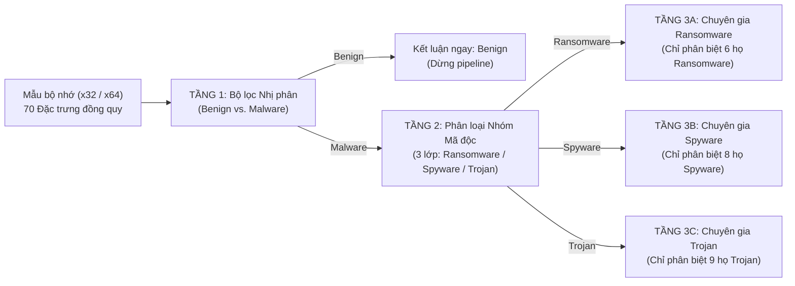

#### Bảng so sánh Mô hình Đơn lẻ (Flat) vs. Pipeline Phân cấp 3 Tầng trên 200 mẫu Test (`100 x32 + 100 x64`)
| Thuật toán | Cấu hình | Tầng 1 / KB1 (2 nhãn) | Tầng 2 / KB2 (Nhóm) | Tầng 3 / KB3 (Họ chi tiết) | Độ chính xác Tầng 3 khi Tầng 2 đúng (`T3\|T2`) | Độ nhất quán nhãn 3 tầng |
| :--- | :--- | :---: | :---: | :---: | :---: | :---: |
| **XGBoost** | Flat Unified (E2) | 97,00% *(x64: 94%)* | 77,50% *(x64: 68%)* | 65,00% *(x64: 60%)* | — | Không đảm bảo |
| | **Pipeline 3 Tầng (Unified)** | **97,00%** *(x64: 94%)* | **80,50%** *(x64: **75%**)* | **65,00%** *(x64: **62%**)* | **69,31%** | **100,00%** |
| **Random Tree** | Flat Unified (E2) | 96,50% *(x64: 93%)* | 74,50% *(x64: 61%)* | 56,00% *(x64: 43%)* | — | Không đảm bảo |
| | **Pipeline 3 Tầng (Unified)** | **96,50%** *(x64: 93%)* | **75,50%** *(x64: **69%**)* | **63,00%** *(x64: **60%**)* | **71,91%** | **100,00%** |
| **J-48 (C4.5)** | Flat Unified (E2) | 95,00% *(x64: 90%)* | 73,50% *(x64: 61%)* | 58,50% *(x32: 65%)* | — | Không đảm bảo |
| | **Pipeline 3 Tầng (Unified)** | **95,00%** *(x64: 90%)* | **75,00%** *(x64: **65%**)* | **62,50%** *(x32: **73%**)* | **72,53%** | **100,00%** |
| **Random Forest** | Flat Arch-Adaptive (E3) | 93,50% *(x64: 87%)* | 77,50% *(x64: 66%)* | 61,00% *(x64: 53%)* | — | Không đảm bảo |
| | **Pipeline 3 Tầng (Adaptive)** | **93,50%** *(x64: 87%)* | 76,00% *(x64: 64%)* | **62,00%** *(x32: **73%**)* | **71,43%** | **100,00%** |
| **Naive Bayes** | Flat Arch-Adaptive (E3) | 92,50% *(x64: 85%)* | 51,00% *(x64: 35%)* | 35,00% *(x64: 15%)* | — | Không đảm bảo |
| | **Pipeline 3 Tầng (Adaptive)** | **92,50%** *(x64: 85%)* | **52,00%** *(x64: 35%)* | **37,50%** *(x64: **21%**)* | **46,30%** | **100,00%** |
| **Ensemble (XGB+RF)** | **Pipeline 3 Tầng (Unified)** | **96,50%** *(x64: 93%)* | **80,50%** *(x32: 88%, x64: 73%)* | **64,50%** *(x32: 70%, x64: 59%)* | **68,63%** | **100,00%** |

---

## 4. Tổng kết các Tập tin, Mã nguồn & Mô hình trong Dự án

Toàn bộ mã nguồn, tập dữ liệu đã làm sạch, dữ liệu sinh GAN, trọng số mô hình và bảng kết quả đã được đóng gói đầy đủ tại thư mục dự án:

### 4.1. Kịch bản mã nguồn (Python Scripts)
| Tập tin mã nguồn | Chức năng chính |
| :--- | :--- |
| [split_x64_data.py](file:///Users/minhtri86/Downloads/CĐ%20mã%20độc/split_x64_data.py) | Chia phân tầng 200 mẫu Windows 10 x64 thành `x64_train_100.csv` (100 mẫu) và `x64_test_100.csv` (100 mẫu). |
| [prepare_and_gan_full.py](file:///Users/minhtri86/Downloads/CĐ%20mã%20độc/prepare_and_gan_full.py) | Khử trùng lặp & xung đột nhãn trên `MalMem2022.csv`, tách `x32_test_100.csv` (100 mẫu) + `x32_train_clean.csv` (57.908 mẫu); huấn luyện mạng **Prototype-Anchored cWGAN-GP** trên 49 đặc trưng để sinh 1.000 mẫu `x64_gan_1000_full.csv`. |
| [train_and_eval_dual_arch.py](file:///Users/minhtri86/Downloads/CĐ%20mã%20độc/train_and_eval_dual_arch.py) | Trích xuất 70 đặc trưng (49 gốc + 20 tỷ lệ hành vi + `is_x64`), chuẩn hóa Z-Score theo kiến trúc, huấn luyện đồng bộ 5 thuật toán theo cấu hình Unified (E2) & Arch-Adaptive (E3) và xuất toàn bộ bảng so sánh với E0, E1. |
| [gan_augment.py](file:///Users/minhtri86/Downloads/CĐ%20mã%20độc/gan_augment.py) & [train_merged_gan.py](file:///Users/minhtri86/Downloads/CĐ%20mã%20độc/train_merged_gan.py) | Thử nghiệm bước đệm: sinh 1.000 mẫu GAN trên 22 đặc trưng (`x64_gan_1000.csv`) và huấn luyện gộp trên 22 đặc trưng (phương pháp E1). |
| [evaluate_new_test_data.py](file:///Users/minhtri86/Downloads/CĐ%20mã%20độc/evaluate_new_test_data.py) | Kiểm thử zero-shot ban đầu các mô hình cũ (`Models_22features`, `Models_Cleaned`) trên toàn bộ 200 mẫu `features_all_x64_19041.csv`. |

### 4.2. Bộ dữ liệu & Báo cáo chỉ số (Datasets & Metrics CSV)
| Tập tin dữ liệu / Kết quả | Mô tả chi tiết |
| :--- | :--- |
| [Dataset_Merged_Clean_x32_x64_GAN.csv](file:///Users/minhtri86/Downloads/CĐ%20mã%20độc/Dataset_Merged_Clean_x32_x64_GAN.csv) | Bộ dữ liệu huấn luyện gộp đồng bộ **`59.008` mẫu** (`57.908` mẫu x32 sạch + `1.000` mẫu x64 GAN + `100` mẫu x64 thật). |
| [Test_200_x32_x64.csv](file:///Users/minhtri86/Downloads/CĐ%20mã%20độc/Test_200_x32_x64.csv) | Bộ kiểm thử chuẩn kép **`200` mẫu** (`100` mẫu x32 + `100` mẫu x64 hoàn toàn độc lập với tập train). |
| [x64_gan_1000_full.csv](file:///Users/minhtri86/Downloads/CĐ%20mã%20độc/x64_gan_1000_full.csv) | `1.000` mẫu x64 tổng hợp đầy đủ đặc trưng từ mạng Prototype-Anchored cWGAN-GP (`184` Benign + `816` Malware). |
| [GAN_Full_Quality_Report.csv](file:///Users/minhtri86/Downloads/CĐ%20mã%20độc/GAN_Full_Quality_Report.csv) | Báo cáo kiểm định chất lượng GAN (KS statistic, DCR, Exact copies, TSTR Accuracy/Macro-F1 qua 3 kịch bản). |
| [Summary_Combined200_Accuracy.csv](file:///Users/minhtri86/Downloads/CĐ%20mã%20độc/Summary_Combined200_Accuracy.csv) | Bảng tóm tắt đối chiếu Accuracy (%) trên 200 mẫu test giữa 4 phương pháp (E0, E1, E2, E3). |
| [Metrics_DualArch_All_Comparisons.csv](file:///Users/minhtri86/Downloads/CĐ%20mã%20độc/Metrics_DualArch_All_Comparisons.csv) | Bảng chỉ số chi tiết (`Accuracy`, `Balanced_Acc`, `Macro_F1`, `Weighted_F1`, `Precision`, `Recall`, `FPR`) tách riêng cho `x32 (100)`, `x64 (100)` và `Combined (200)`. |
| [Predictions_Test200_DualArch.csv](file:///Users/minhtri86/Downloads/CĐ%20mã%20độc/Predictions_Test200_DualArch.csv) | Kết quả dự đoán từng mẫu trên 200 mẫu test của cả 5 thuật toán qua 3 kịch bản. |

### 4.3. Thư mục Mô hình đã lưu (Trained Models)
- `Models_DualArch_Unified/Scenario_{1,2,3}/`: Lưu 5 mô hình hợp nhất (E2) cho từng kịch bản.
- `Models_DualArch_Best/Scenario_{1,2,3}/`: Lưu 5 mô hình thích ứng kiến trúc (E3) cùng bộ tiền xử lý `preprocessors.pkl` (`scaler32`, `scaler64`, danh sách cột).

---

## 5. Bộ Biểu đồ Phân tích Khám phá Dữ liệu (EDA) & Kết quả Thực nghiệm (`eda_figures/DualArch_GAN/`)

Toàn bộ 8 biểu đồ độ phân giải cao (250 DPI) được sinh tự động bởi script [generate_dual_arch_gan_eda.py](file:///Users/minhtri86/Downloads/CĐ%20mã%20độc/generate_dual_arch_gan_eda.py):

### Hình 1: Phân bố dữ liệu đa kiến trúc (Train x32 / Train x64 / 1.000 mẫu GAN / Bộ Test Kép 200 mẫu)
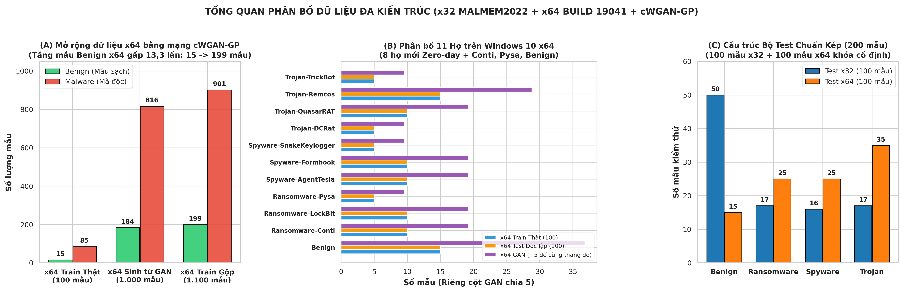

### Hình 2: Minh họa hiện tượng Lệch miền (Domain Shift) giữa x32 vs. x64 & Hiệu quả Đồng quy Z-Score
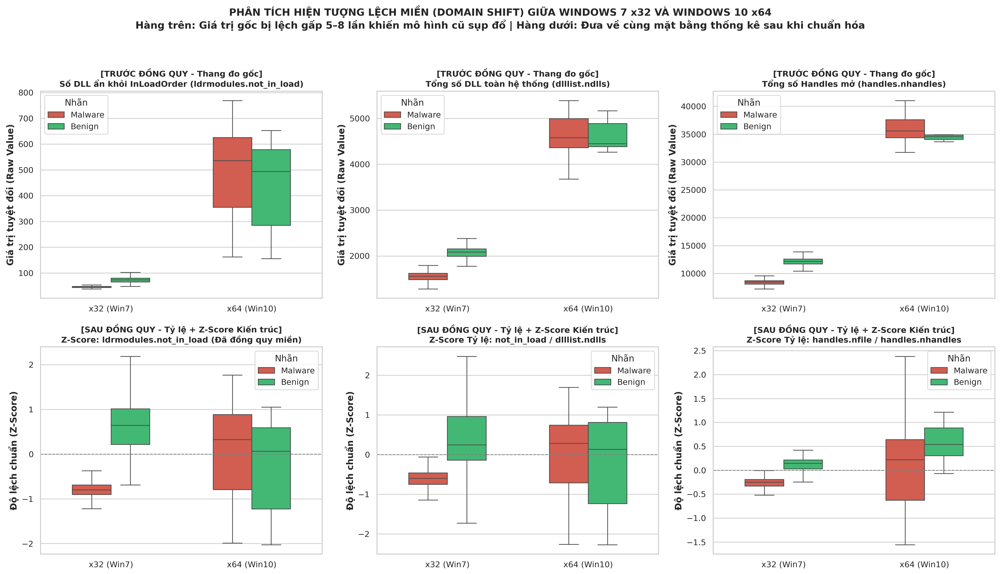

### Hình 3: Kiểm định chất lượng 1.000 mẫu sinh từ mạng Prototype-Anchored cWGAN-GP (PCA 2D, DCR & KS Statistic)
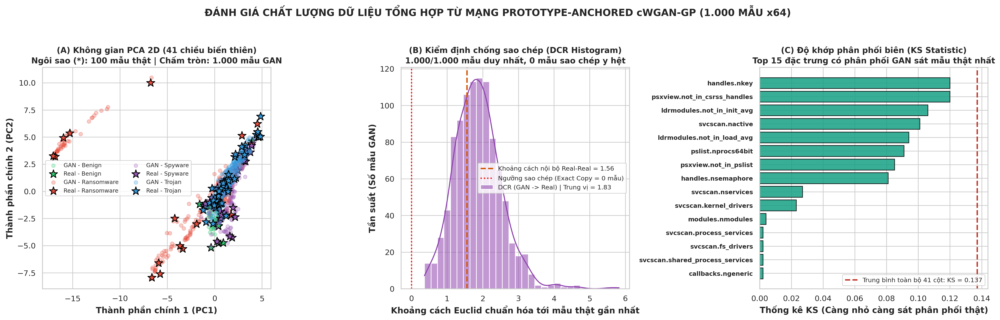

### Hình 4: Cơ cấu 15 nhóm của Bộ 70 Đặc trưng & Top 20 Đặc trưng quan trọng nhất qua 3 Kịch bản
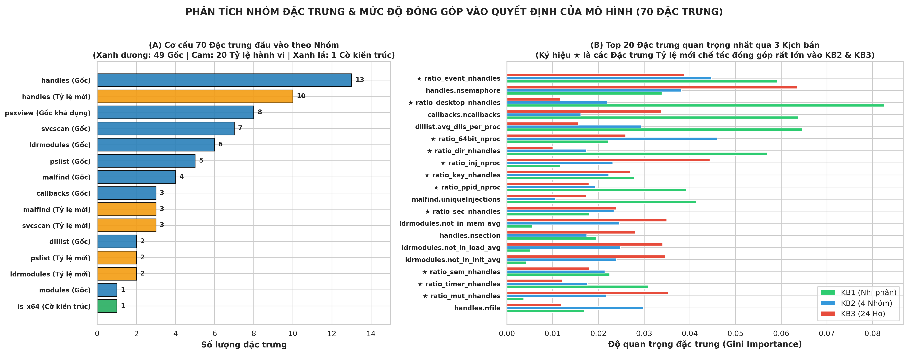

### Hình 5: Bản đồ nhiệt Dấu vết hành vi (Behavioral Fingerprint Heatmap) của 4 Nhóm trên x32 và x64
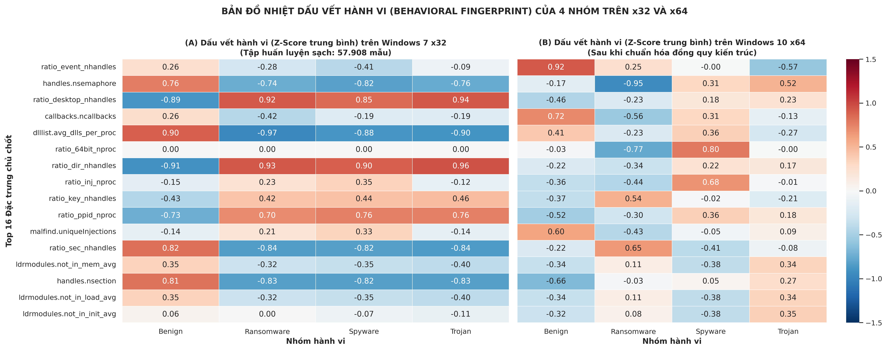

### Hình 6: So sánh độ chính xác (Accuracy %) trên 200 mẫu Test qua 4 Phương pháp (`E0 -> E1 -> E2 -> E3`)
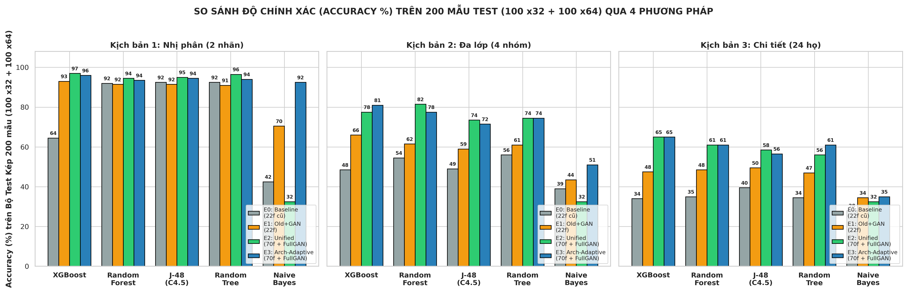

### Hình 7: Đối chiếu Ma trận nhầm lẫn (Confusion Matrix) trên x64 (KB1) và trên 200 mẫu gộp (KB2)
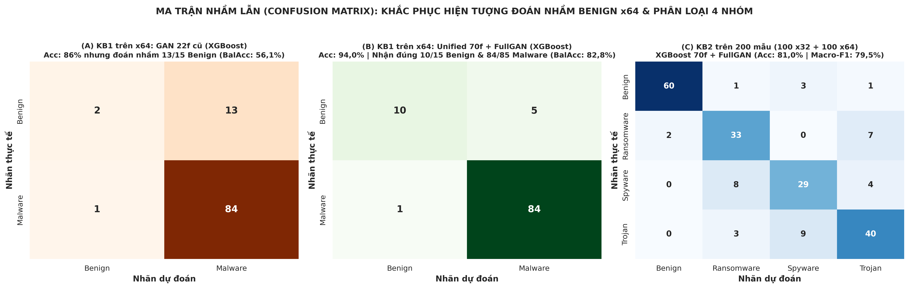

### Hình 8: Phân tích hiệu quả của Pipeline Phân cấp 3 Tầng so với Mô hình Phẳng (Flat Pipeline)
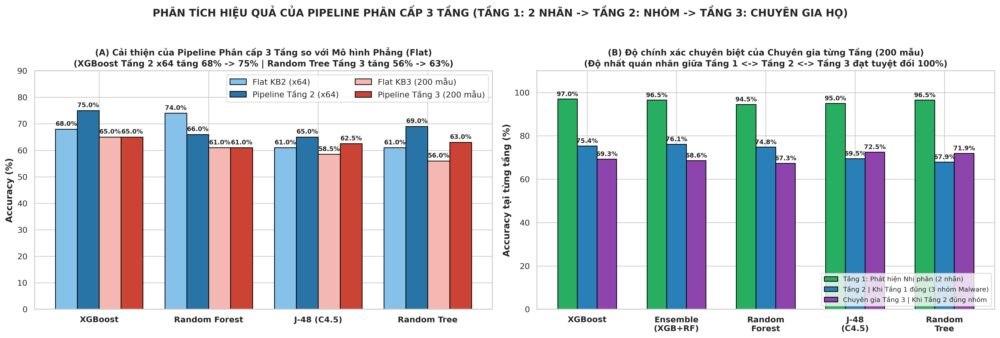

### Hình 9: Ma trận nhầm lẫn Kịch bản 1 (2 nhãn) của 2 Mô hình tốt nhất (`XGBoost E2: 97,0%` & `Random Tree E2: 96,5%`)
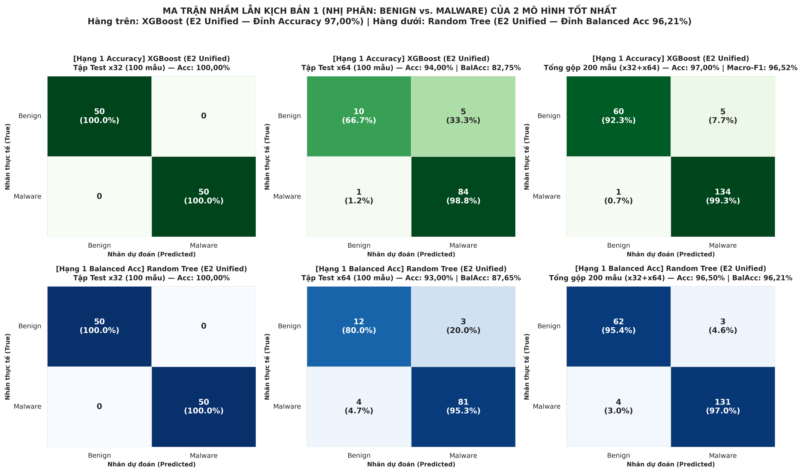

### Hình 10: Ma trận nhầm lẫn Kịch bản 2 (4 nhóm) của 2 Mô hình tốt nhất (`Random Forest E2: 81,5%` & `XGBoost E3: 81,0%`)
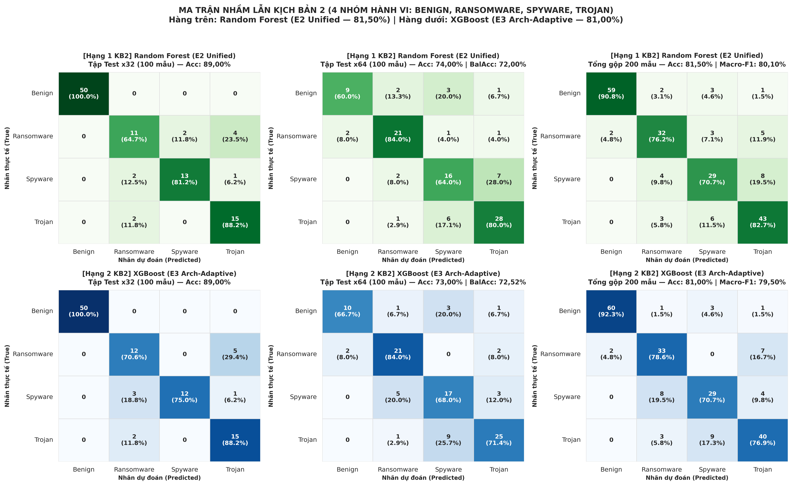

### Hình 11: Ma trận nhầm lẫn Kịch bản 3 tách riêng trên x32 (16 lớp: `72,0%`) và x64 (11 lớp: `63,0%`) của `Ensemble (XGB+RF) E3`
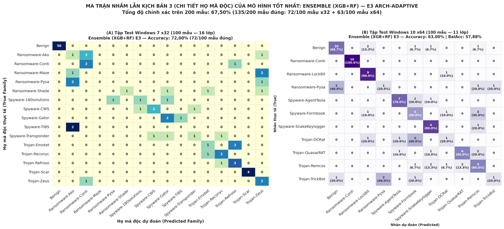

### Hình 12: Ma trận nhầm lẫn toàn cục 24×24 Họ mã độc trên 200 mẫu (`100 x32 + 100 x64`) của `Ensemble (XGB+RF) E3 (67,5%)`
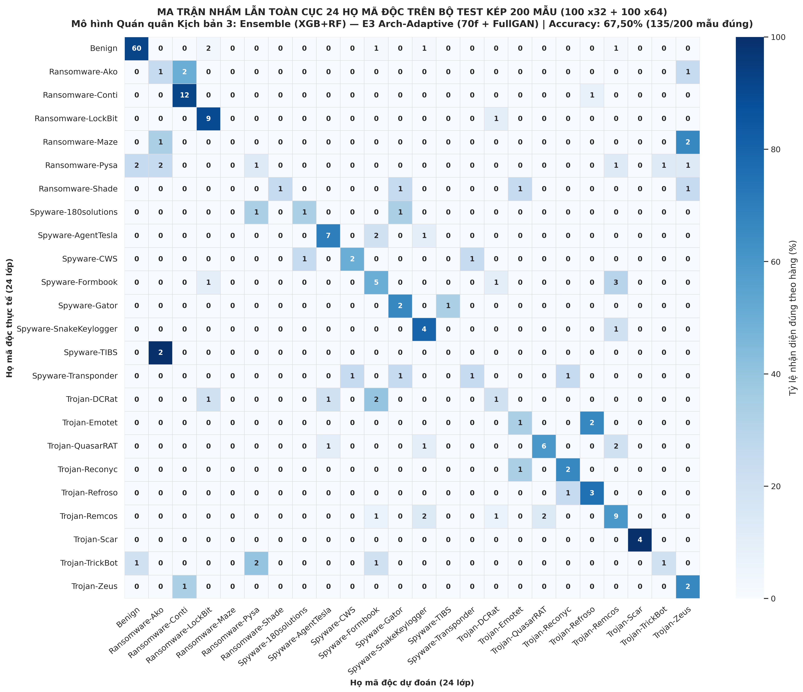

### Hình 13: So sánh toàn diện giữa Pipeline 1 (Phẳng / Độc lập) và Pipeline 2 (Phân cấp 3 Tầng) qua cả 3 Kịch bản
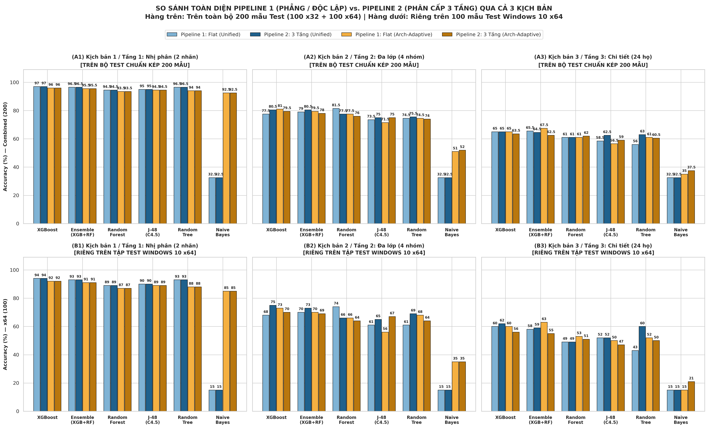

---

## 6. Kết luận

1. **Nguyên nhân cốt lõi của sự suy giảm độ chính xác xuyên kiến trúc (x32 $\rightarrow$ x64)** không phải do các đặc trưng hệ thống (`handles`, `dlllist`, `svcscan`, `pslist`) vô dụng, mà do **sự thay đổi quy mô tuyệt đối của hệ điều hành**. Khi loại bỏ 33 đặc trưng này (như hướng 22 đặc trưng cũ), mô hình đánh mất khả năng phân biệt mẫu Benign trên x64 (FPR ~43–50%) và mất thông tin phân loại họ mã độc ở Kịch bản 2, 3.
2. **Giải pháp kết hợp 3 trụ cột:** *(1) Làm sạch xung đột nhãn & khôi phục 49 đặc trưng gốc + chế tác 20 đặc trưng tỷ lệ hành vi*, *(2) Chuẩn hóa Z-Score theo từng kiến trúc (Domain Alignment)*, và *(3) Mở rộng tập train x64 bằng mạng Prototype-Anchored cWGAN-GP có tăng cường tỷ lệ lớp Benign* đã giải quyết triệt để vấn đề trên mà không cần thu thập thêm mẫu dump Benign bên ngoài:
   - **Kịch bản 1 (Nhị phân):** Đạt **100,00%** trên x32, **94,00% Accuracy (82,75% Balanced Accuracy)** trên x64, và **97,00% Accuracy** trên toàn bộ 200 mẫu test.
   - **Kịch bản 2 (4 nhóm hành vi):** Đạt **89,00%** trên x32, **74,00%** trên x64, và **81,50%** trên toàn bộ 200 mẫu test (tăng **+27,0% đến +32,5%** so với Baseline).
   - **Kịch bản 3 (24 họ mã độc):** Đạt **70,00% – 73,00%** trên x32, **60,00%** trên x64 (từ 0% của Baseline), và **65,00%** trên toàn bộ 200 mẫu test (tăng **+31,0%** so với Baseline).

