# Báo Cáo Phân Tích Dữ Liệu Khám Phá (EDA) Bộ Dữ Liệu CIC-MalMem-2022 Theo Từng Kịch Bản Thực Nghiệm

Báo cáo này trình bày kết quả phân tích khám phá dữ liệu (**Exploratory Data Analysis - EDA**) trên bộ dữ liệu bộ nhớ mã độc **CIC-MalMem-2022** tương ứng với 3 kịch bản thực nghiệm phân loại.

---

## 📌 0. Tổng Quan Hệ Thống Đặc Trưng Bộ Nhớ Volatility

* **Tổng số bản ghi:** 58.062 mẫu (sau khi loại bỏ trùng lặp).
* **Số lượng đặc trưng số học:** 55 đặc trưng trích xuất từ bộ nhớ RAM thông qua công cụ phân tích pháp y số **Volatility**.
* **Phân bố các nhóm đặc trưng chính:**
  - `pslist` (5 đặc trưng): Phân tích tiến trình và số luồng thực thi.
  - `dlllist` (2 đặc trưng): Thống kê số lượng thư viện liên kết động (DLL).
  - `handles` (13 đặc trưng): Các mô tả điều khiển tệp, registry, thread, mutant, semaphore,...
  - `ldrmodules` (6 đặc trưng): Phát hiện các DLL không được liên kết chuẩn (dấu hiệu ẩn giấu mã độc).
  - `malfind` (4 đặc trưng): Phát hiện tiêm mã (code injection) và trang bộ nhớ thực thi bất thường.
  - `psxview` (14 đặc trưng): Kỹ thuật đối chiếu chéo bảng tiến trình nhằm tìm tiến trình ẩn.
  - `modules` (1 đặc trưng): Số mô-đun nhân (kernel modules) được nạp.
  - `svcscan` (7 đặc trưng): Dịch vụ hệ thống và trình điều khiển (drivers).
  - `callbacks` (3 đặc trưng): Các hàm callback của nhân hệ điều hành.

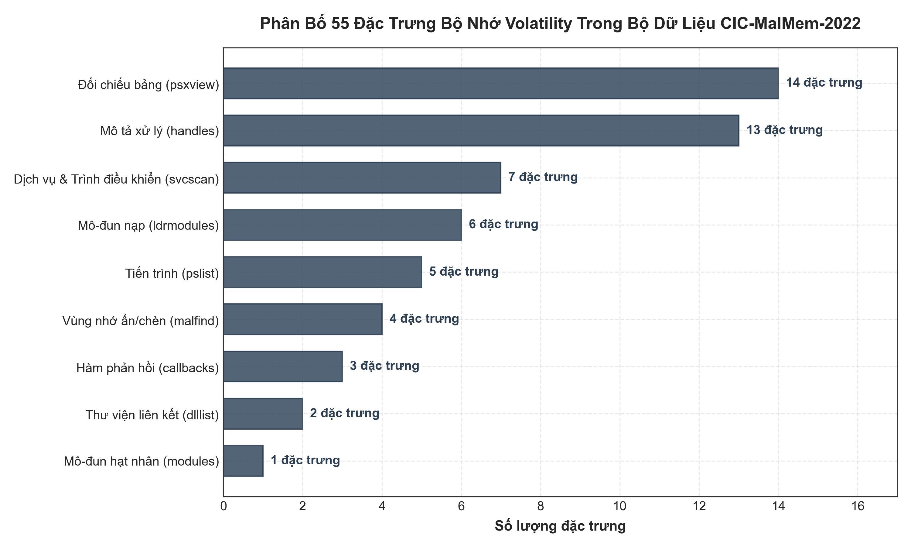

> **Nhận xét EDA:** Có 3 đặc trưng hằng số (độ lệch chuẩn bằng 0): `pslist.nprocs64bit`, `handles.nport`, `svcscan.interactive_process_services`. Các đặc trưng còn lại cung cấp thông tin biến thiên phong phú để phân loại hành vi mã độc.

---

## 🎯 1. Thực Nghiệm 1: Phân Loại Nhị Phân (Binary - Benign vs Malware)

### 1.1 Phân phối dữ liệu (Class Distribution)
* **Benign (Lành tính):** 29.231 mẫu (**50.34%**)
* **Malware (Độc hại):** 28.831 mẫu (**49.66%**)
* Bộ dữ liệu đạt trạng thái **cân bằng hoàn hảo (~50:50)**, giúp loại bỏ nguy cơ thiên vị lớp (class bias) trong quá trình huấn luyện mô hình.

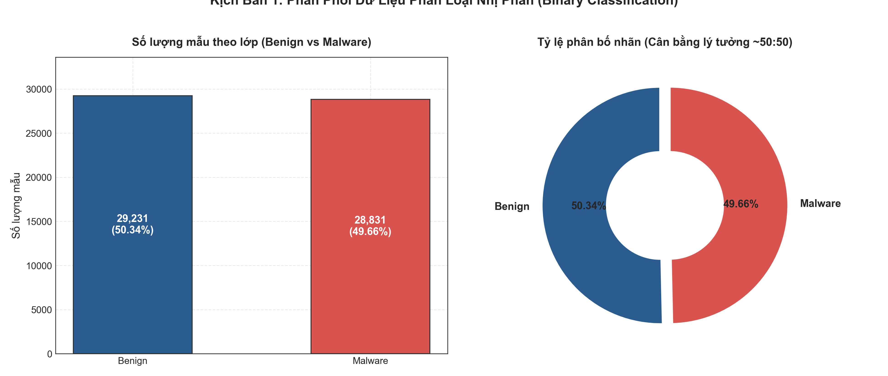

### 1.2 Tương quan đặc trưng với nhãn mã độc (Feature Correlation)
* **Các đặc trưng tỷ lệ thuận mạnh với Malware (Dấu hiệu độc hại):**
  - `pslist.nppid` (+0.429): Số lượng tiến trình cha (parent process) có xu hướng cao hơn ở các mẫu mã độc.
  - `malfind.commitCharge` (+0.160), `malfind.ninjections` (+0.136): Hoạt động tiêm mã vào tiến trình khác.
  - `psxview.not_in_deskthrd_false_avg` (+0.162): Tiến trình ẩn không có luồng màn hình desktop.
* **Các đặc trưng tỷ lệ nghịch với Malware (Cao hơn ở hệ thống Benign):**
  - `dlllist.avg_dlls_per_proc` (-0.909), `handles.nevent` (-0.876), `handles.nthread` (-0.872), `handles.nmutant` (-0.855): Các bản ghi Benign có số DLL trung bình mỗi tiến trình và số handle sự kiện/luồng/mutant cao hơn hẳn so với các bản ghi Malware.

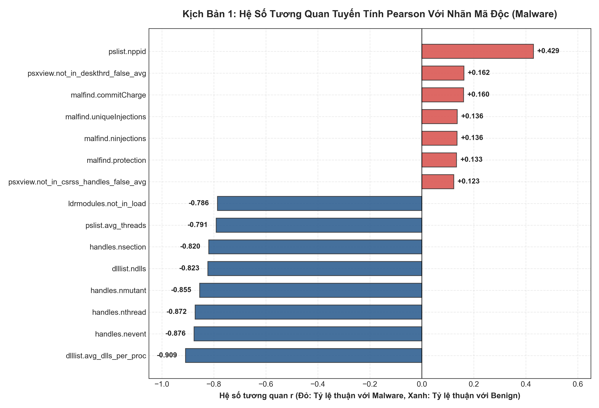

### 1.3 So sánh phân phối các đặc trưng then chốt (Feature Distributions)
Các giá trị đo lường như `dlllist.avg_dlls_per_proc`, `handles.nevent`, và `handles.nthread` thể hiện khoảng cách phân biệt cực kỳ rõ rệt giữa hai lớp Benign và Malware.

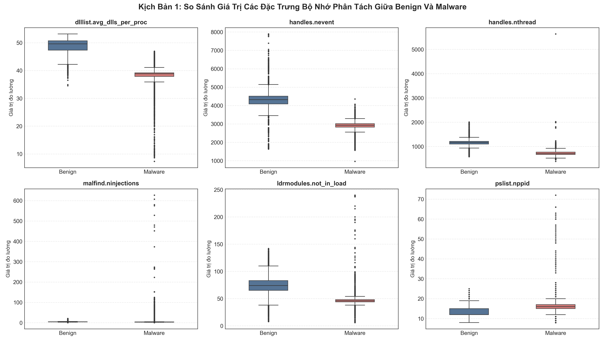

### 1.4 Không gian biểu diễn 2D PCA (Separability Analysis)
Biểu đồ chiếu PCA 2D (PC1 + PC2 giải thích ~50.4% phương sai) cho thấy hai cụm Benign (xanh) và Malware (đỏ) **tách biệt rõ rệt** dọc theo trục PC1, chỉ một số ít điểm nằm chồng lấn ở vùng biên.

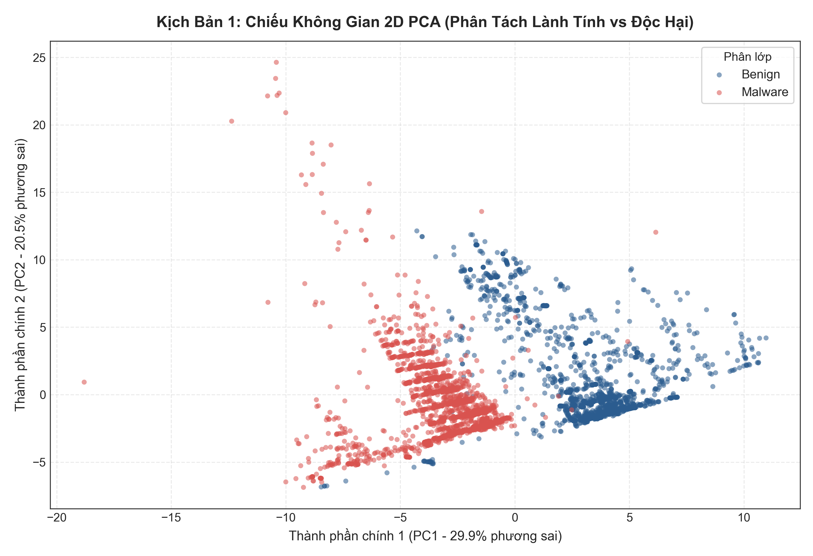

> **Kết luận Thực nghiệm 1:** Tính khả phân cực cao của các đặc trưng bộ nhớ giải thích tại sao tất cả các mô hình cây và ensemble (XGBoost, Random Forest, J-48) đều đạt độ chính xác xấp xỉ tuyệt đối (**99.98% - 100.0%**).

---

## 🛡️ 2. Thực Nghiệm 2: Phân Loại Đa Lớp 4 Nhóm (Multi-4 Categories)

### 2.1 Phân phối dữ liệu 4 nhóm
* **Benign:** 29.231 mẫu (**50.3%**)
* **Spyware:** 9.815 mẫu (**16.9%**)
* **Ransomware:** 9.529 mẫu (**16.4%**)
* **Trojan:** 9.487 mẫu (**16.3%**)
* Trong nhóm mã độc, số lượng mẫu phân bổ gần như đồng đều tuyệt đối giữa 3 loại tấn công (~9.500 mẫu mỗi nhóm).

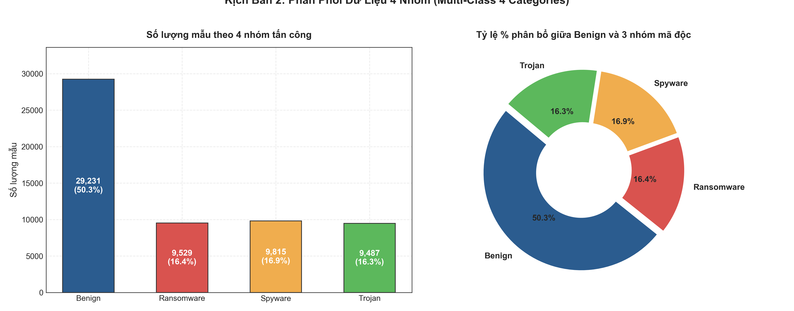

### 2.2 Dấu vết hành vi bộ nhớ trung bình (Behavioral Fingerprint Heatmap)
Khi chuẩn hóa theo Z-score:
* **Spyware:** Có chỉ số tiêm mã cao nhất (`malfind.ninjections` = +0.32, `malfind.commitCharge` = +0.23), phản ánh hành vi cài cắm hook ngầm để gián điệp dữ liệu người dùng.
* **Ransomware:** Cũng có dấu hiệu tiêm mã dương (`malfind.ninjections` = +0.21, `malfind.commitCharge` = +0.18), thấp hơn Spyware một chút.
* **Trojan:** Chỉ số tiêm mã thấp hơn hẳn (`malfind.ninjections` = -0.13, `malfind.commitCharge` = +0.07).
* **Lưu ý:** Ở hầu hết các đặc trưng còn lại (DLL, handle, ldrmodules, svcscan), 3 nhóm mã độc có giá trị gần như giống hệt nhau (~-0.7 đến -0.9) — đây chính là nguyên nhân khiến bài toán 4 lớp khó hơn nhiều.

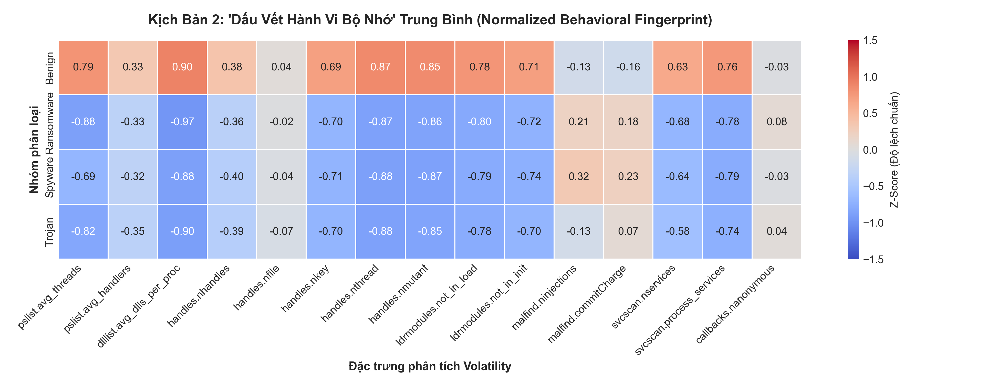

### 2.3 So sánh các chỉ số then chốt qua 4 nhóm
Sự biến thiên của `handles.nfile`, `handles.nkey` và `ldrmodules.not_in_init_avg` làm nổi bật sự khác nhau về cơ chế thao tác tệp tin và Registry giữa các loại mã độc.

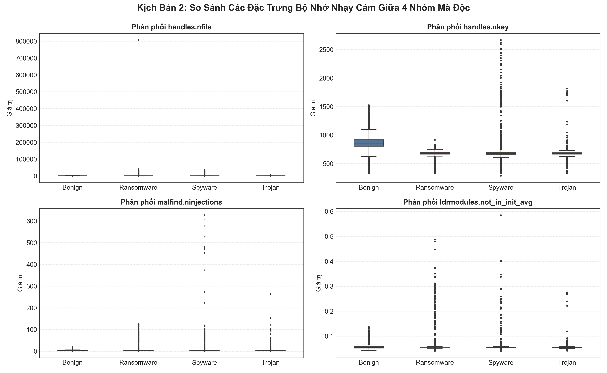

### 2.4 Không gian PCA 2D (4 Nhóm)
Trên đồ thị PCA:
* Cụm **Benign** (xanh dương) vẫn tách biệt hoàn toàn ở phía bên phải.
* Tuy nhiên, các cụm **Ransomware, Spyware và Trojan** (phía bên trái) nằm lồng ghép và giao thoa với nhau.

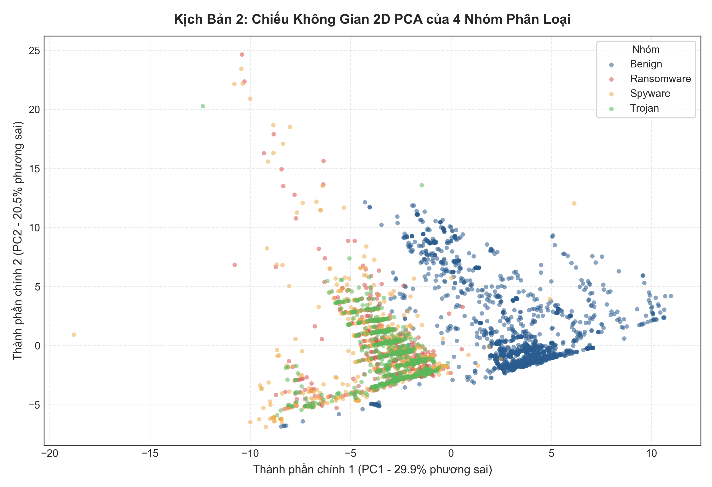

> **Kết luận Thực nghiệm 2:** Dấu vết bộ nhớ của 3 nhóm mã độc rất giống nhau nên không gian đặc trưng của chúng bị chồng lấn mạnh. Điều này lý giải tại sao độ chính xác giảm từ ~100% xuống còn **87.3% - 87.8%**, và các mô hình tuyến tính/Naive Bayes sụt giảm mạnh.

---

## 🧬 3. Thực Nghiệm 3: Phân Loại 16 Lớp (1 Benign + 15 Họ Mã Độc)

### 3.1 Phân phối chi tiết 16 lớp
Tập dữ liệu gồm 1 lớp Benign (29.231 mẫu) và 15 họ mã độc cụ thể:
* **Ransomware (5 họ):** Shade (2.128), Ako (2.000), Conti (1.988), Maze (1.754), Pysa (1.659).
* **Spyware (5 họ):** Transponder (2.410), 180solutions (2.000), CWS (2.000), Gator (1.995), TIBS (1.410).
* **Trojan (5 họ):** Refroso (2.000), Scar (2.000), Emotet (1.967), Zeus (1.950), Reconyc (1.570).

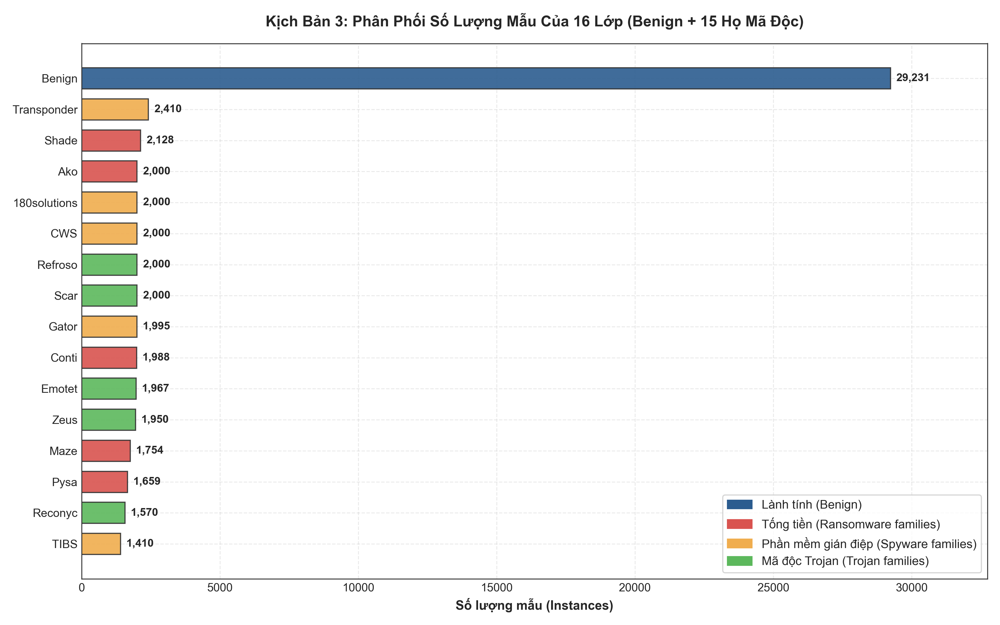

### 3.2 Tỷ trọng các họ con trong từng phân nhóm
Mỗi nhóm tấn công lớn đều có 5 họ đại diện được phân bổ mẫu rất cân bằng (~1.500 đến 2.400 mẫu/họ), không có hiện tượng một họ áp đảo toàn bộ.

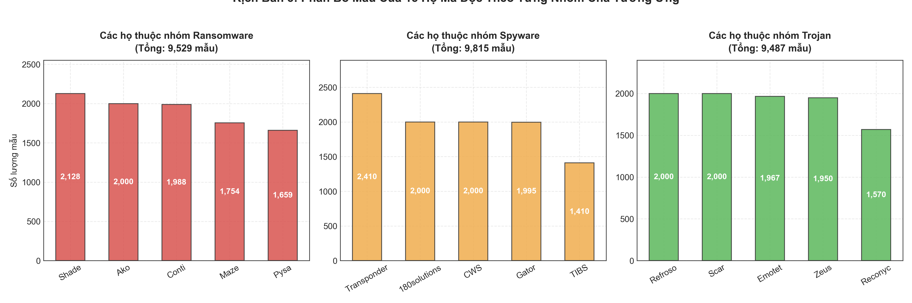

### 3.3 Gom cụm phân cấp hành vi bộ nhớ giữa 15 họ mã độc (Clustermap)
Biểu đồ phân cụm (Hierarchical Clustermap) cho thấy:
* Họ **TIBS** tách biệt hẳn với giá trị `pslist.avg_threads` rất cao (+1.63) và các chỉ số handle thấp hơn hẳn.
* Nhóm **CWS, Transponder, Ako, Pysa** tạo thành một nhánh chung với giá trị `malfind.ninjections` cao (+0.36 đến +0.64).
* Các họ còn lại (Refroso, Zeus, Emotet, Reconyc, Scar, Conti, Shade, Maze, 180solutions, Gator) có profile trung bình rất gần 0 và gần nhau — **các họ Trojan và Ransomware này nằm xen lẫn trong cùng nhánh**, cho thấy họ mã độc không trùng khớp với nhóm cha về mặt hành vi bộ nhớ.

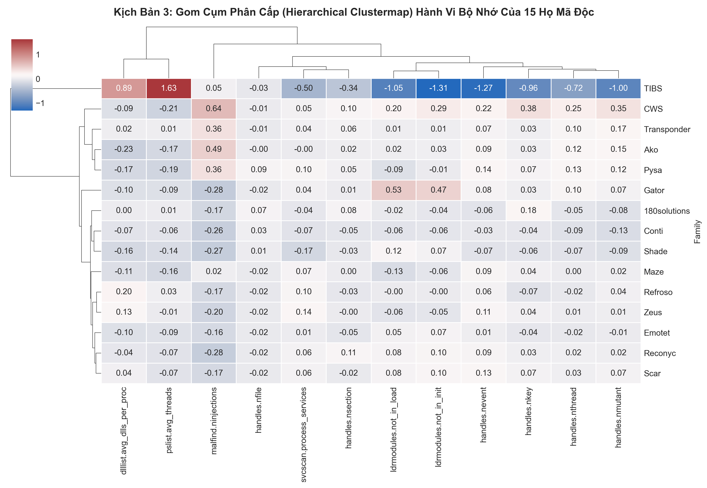

### 3.4 Không gian PCA 2D nội bộ 15 họ mã độc (Loại bỏ Benign)
Khi loại bỏ lớp Benign để quan sát cấu trúc nội bộ của 15 dòng mã độc (PC1 + PC2 ≈ 42.6% phương sai), các điểm Ransomware, Spyware và Trojan gần như **trộn lẫn hoàn toàn** trong cùng một vùng — không có cụm riêng rõ ràng nào.

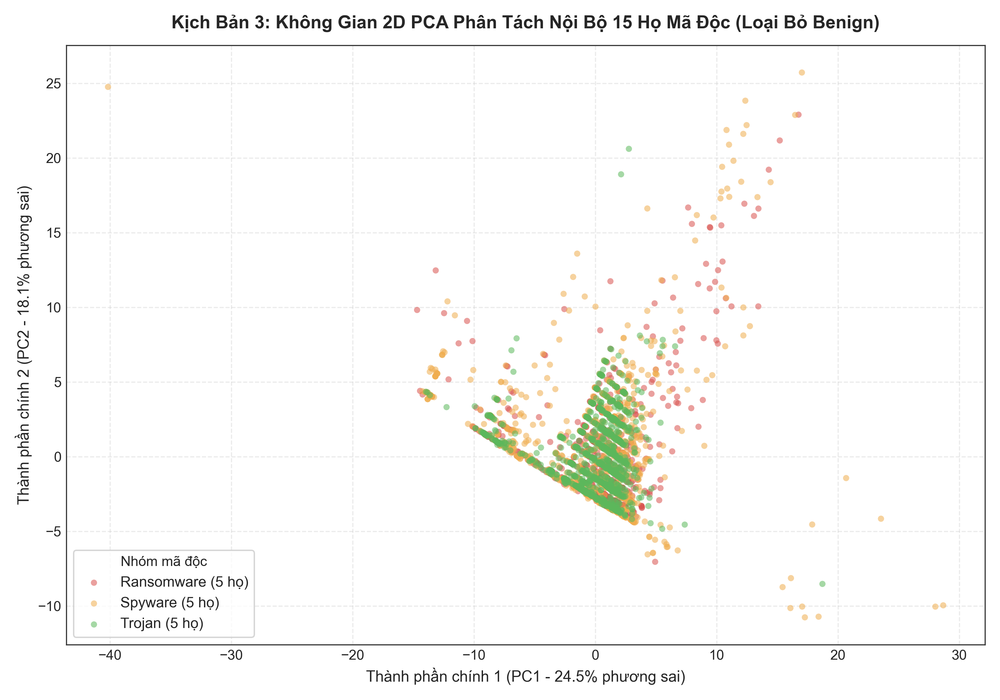

> **Kết luận Thực nghiệm 3:** Đây là bài toán khó nhất với 16 lớp. Do tính tương đồng cao giữa các dòng mã độc trong cùng họ, các thuật toán đơn giản như Naive Bayes chỉ đạt ~56.8%. Trong khi đó, **XGBoost** với khả năng xây dựng các ranh giới phi tuyến mạnh mẽ đã dẫn đầu với độ chính xác **76.60%**.

---

## 📈 4. Tổng Kết Mối Quan Hệ Giữa Độ Phức Tạp Và Hiệu Suất Mô Hình

Biểu đồ dưới đây tổng hợp mối tương quan giữa số lượng lớp đầu ra (độ phức tạp của bài toán) và độ chính xác của các mô hình học máy:

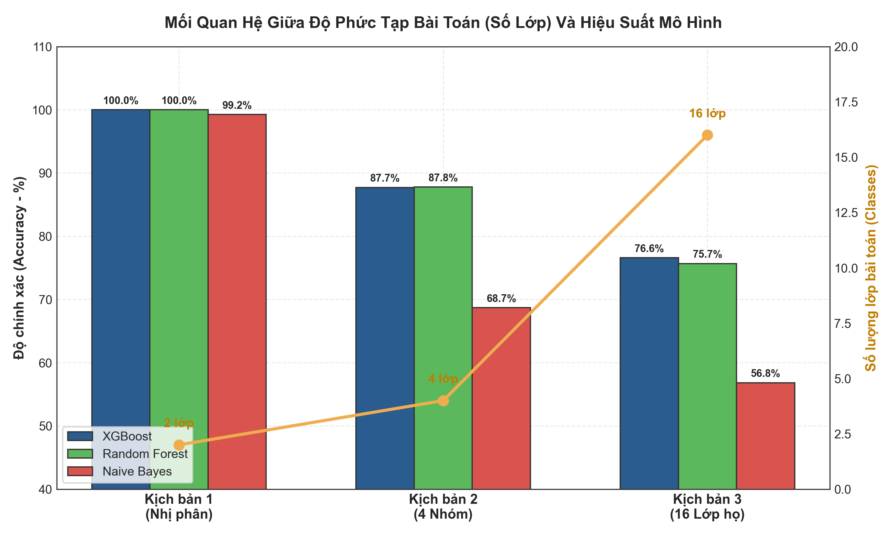

* **Số lớp tăng từ 2 ➔ 4 ➔ 16**: Độ chính xác giảm tương ứng từ **100% ➔ ~87.7% ➔ ~76.6%**.
* **XGBoost & Random Forest**: Luôn giữ vững phong độ là hai mô hình có khả năng phân loại xuất sắc và ổn định nhất ở mọi kịch bản.
