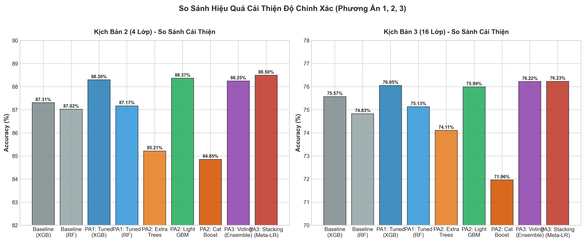

# Detection and Analysis of Malicious Software Using Machine Learning Models (CIC-MalMem-2022)

Repository này chứa mã nguồn Python nhằm tái hiện lại các kịch bản thực nghiệm phân loại mã độc dựa trên bộ dữ liệu **CIC-MalMem-2022**. Mã nguồn thực hiện quá trình tiền xử lý, huấn luyện và đánh giá 5 thuật toán Học máy (Random Tree, Random Forest, J-48, Naive Bayes, XGBoost) qua 3 kịch bản phân loại với 2 phương pháp kiểm thử (Percentage Split 80% và 10-Fold Cross-Validation).

## 📥 Tải xuống Bộ dữ liệu (Dataset)

Để chạy mã nguồn, bạn cần tải xuống tập dữ liệu gốc `MalMem2022.csv`.
🔗 **[Tải xuống Dataset CIC-MalMem-2022 (Google Drive)](https://drive.google.com/drive/folders/1TooIQ5HmU1n5X34zYpIgmtTW49X9_QMY?usp=sharing)**

Sau khi tải xong, hãy đặt file `MalMem2022.csv` vào thư mục gốc của repository này.

## 🚀 Hướng dẫn Sử dụng

1. **Cài đặt thư viện yêu cầu:**
   Bạn cần cài đặt các thư viện Python:
   ```bash
   pip install pandas numpy scikit-learn xgboost lightgbm catboost joblib matplotlib seaborn
   ```

2. **Chạy kịch bản thực nghiệm tái hiện bài báo (5 mô hình gốc):**
   Đảm bảo file `MalMem2022.csv` đã nằm trong thư mục gốc. Chạy lệnh sau:
   ```bash
   python3 reproduce_experiment.py
   ```

   **Mã nguồn sẽ tự động thực hiện:**
   - Xóa bỏ dữ liệu trùng lặp (giữ lại 58.062 mẫu hợp lệ).
   - Xuất dữ liệu đã chuẩn hóa của 3 kịch bản ra các file CSV (`Dataset_Scenario_1.csv`, `Dataset_Scenario_2.csv`, v.v.).
   - Lưu trữ trọng số mô hình đã huấn luyện (file `.pkl`) và tham số (file `.json`) vào thư mục `Models/`.
   - Xuất bảng chỉ số đánh giá ra các file `Metrics_Scenario_*.csv`.

3. **Vẽ các biểu đồ phân tích khám phá dữ liệu (EDA) theo từng kịch bản:**
   ```bash
   python3 generate_eda.py
   ```
   Ảnh được lưu trong thư mục `eda_figures/` (`Overview/`, `Scenario_1/`, `Scenario_2/`, `Scenario_3/`). Phân tích chi tiết: [EDA_Report.md](EDA_Report.md).

4. **Chạy thực nghiệm cải tiến nâng cao độ chính xác (Phương án 1, 2, 3):**
   ```bash
   python3 improve_experiment.py
   ```
   Tự động huấn luyện, tối ưu hóa siêu tham số (Tuning), thử nghiệm mô hình mới (LightGBM, ExtraTrees, CatBoost) và kết hợp đa mô hình (Soft Voting, Stacking Classifier), lưu kết quả vào `Improvement_Scenario_2.csv` và `Improvement_Scenario_3.csv`.

*(Ghi chú: Các file Dataset dung lượng lớn và file model nặng đã được `.gitignore` để tránh phình to kích thước repository).*

---

## 🧪 Môi Trường Lab Ảo Hóa Phân Tích Mã Độc (Vagrant & VirtualBox)

Để tạo lập dữ liệu hoặc phân tích động các mẫu mã độc PE trong môi trường an toàn, repository cung cấp cấu hình Sandbox sẵn sàng hoạt động trong thư mục `lab/`:
- **Hạ tầng:** Tự động hóa bằng [Vagrant](https://www.vagrantup.com/) trên nền tảng ảo hóa [Oracle VirtualBox](https://www.virtualbox.org/).
- **Hệ điều hành máy ảo (Guest VM):** Windows 10 x64 (`Win10_Malware_Mem_Demo`).
- **Cơ chế an toàn (Hardened Isolation):** Đã vô hiệu hóa hoàn toàn Shared Folders, Clipboard hai chiều, Kéo thả tệp (Drag & Drop) và các cổng giao tiếp USB/Serial/LPT nhằm loại trừ nguy cơ mã độc lây lan ngược ra máy thật (Host).
- **Chu trình phân tích bộ nhớ:**
  1. Chạy máy ảo từ Clean Snapshot: `cd lab && vagrant up`
  2. Thực thi mẫu PE mã độc.
  3. Trích xuất ảnh chụp RAM: `VBoxManage debugvm "Win10_Malware_Mem_Demo" dumpvmcore --filename malware.raw`
  4. Dùng **Volatility 3** trích xuất 55 đặc trưng tương thích định dạng CIC-MalMem-2022.

👉 Xem toàn bộ hướng dẫn cài đặt, cấu hình, quản lý snapshot và khắc phục sự cố tại: 🔗 **[lab/README.md](lab/README.md)**

---

## 🔍 Phân Tích Dữ Liệu Khám Phá (EDA)

### Kịch bản 1 – Nhị phân (Benign vs Malware)
Dữ liệu cân bằng gần 50:50 (29.231 Benign / 28.831 Malware). Hai lớp tách biệt rõ trong không gian PCA, các đặc trưng như `dlllist.avg_dlls_per_proc` (r = -0.91) và `handles.nevent` (r = -0.88) phân biệt rất mạnh.

| Phân phối lớp | PCA 2D |
| :---: | :---: |
|  |  |

### Kịch bản 2 – 4 nhóm (Benign, Ransomware, Spyware, Trojan)
3 nhóm mã độc có số mẫu gần bằng nhau (~9.500 mẫu mỗi nhóm) nhưng dấu vết bộ nhớ gần như giống hệt nhau, nên chồng lấn mạnh trong PCA.

| Dấu vết hành vi (Z-score) | PCA 2D |
| :---: | :---: |
|  |  |

### Kịch bản 3 – 16 lớp (Benign + 15 họ mã độc)
Mỗi họ có ~1.400–2.400 mẫu. Khi gom cụm phân cấp, phần lớn các họ có profile rất giống nhau và không gom theo nhóm cha, nên đây là kịch bản khó nhất.

| Phân phối 16 lớp | Gom cụm 15 họ mã độc |
| :---: | :---: |
|  |  |


---

## 📊 Kết Quả Thực Nghiệm (Tái hiện)

Dưới đây là tóm tắt độ chính xác (Accuracy) đạt được sau quá trình chạy mô phỏng bằng Python. Nhìn chung, kết quả bám rất sát và phản ánh đúng xu hướng của bài báo gốc.

### 1. Kịch bản Phân loại Nhị phân (Binary - 2 lớp: Benign và Malware)
Sự phân tách giữa lành tính và mã độc rất rõ ràng. Các thuật toán Tree-based và Ensemble đều đạt hiệu suất gần như tuyệt đối (100%).

| Mô hình | Phương pháp | Accuracy (Tái hiện) |
| :--- | :--- | :--- |
| **XGBoost** | 80% Split | **100.0%** |
| **Random Forest (RF)** | 80% Split | **100.0%** |
| **J-48 (Decision Tree)**| 80% Split | 99.98% |
| **Naive Bayes (NB)** | 10-Fold CV | 99.25% |

### 2. Kịch bản Đa lớp 4 nhóm (Multi-4: Benign, Ransomware, Spyware, Trojan)
Bài toán trở nên phức tạp hơn, XGBoost và Random Forest là 2 mô hình dẫn đầu, trong khi Naive Bayes giảm sút mạnh.

| Mô hình | Phương pháp | Accuracy (Tái hiện) |
| :--- | :--- | :--- |
| **XGBoost** | 10-Fold CV | **87.71%** |
| **Random Forest (RF)** | 10-Fold CV | **87.78%** |
| **J-48 (Decision Tree)**| 10-Fold CV | 85.09% |
| **Naive Bayes (NB)** | 10-Fold CV | 68.70% |

### 3. Kịch bản Đa lớp 16 nhóm (Multi-16: 1 Benign + 15 họ mã độc)
Trong kịch bản khó nhất (phân biệt chi tiết 15 dòng mã độc), XGBoost thể hiện rõ ưu thế tuyệt đối so với các thuật toán khác.

| Mô hình | Phương pháp | Accuracy (Tái hiện) |
| :--- | :--- | :--- |
| **XGBoost** | 10-Fold CV | **76.60%** |
| **Random Forest (RF)** | 10-Fold CV | 75.68% |
| **J-48 (Decision Tree)**| 10-Fold CV | 73.65% |
| **Naive Bayes (NB)** | 10-Fold CV | 56.83% |

---

## ⚖️ So Sánh Với Bài Báo Gốc

Dưới đây là phần đối chiếu độ chính xác (Accuracy) đạt được từ mã nguồn tái hiện (Python/Scikit-learn/XGBoost) với kết quả công bố trong bài báo gốc (sử dụng công cụ WEKA). Nhìn chung, kết quả bám rất sát bài báo và sự chênh lệch phần lớn nằm ở mức dưới 1%.

### 1. Kịch bản Phân loại Nhị phân (Binary)
| Mô hình | Phương pháp | Kết quả Bài báo | Kết quả Tái hiện | Chênh lệch (Delta) |
| :--- | :--- | :--- | :--- | :--- |
| **XGBoost** | 80% Split | 99.99% | 100.0% | + 0.01% |
| **Random Forest (RF)** | 80% Split | > 99.90% | 100.0% | + 0.10% |
| **J-48 (Decision Tree)**| 80% Split | > 99.90% | 99.98% | + 0.08% |
| **Naive Bayes (NB)** | 10-Fold CV | 98.87% - 98.89% | 99.25% | ~ + 0.36% |

### 2. Kịch bản Đa lớp 4 nhóm (Multi-4)
| Mô hình | Phương pháp | Kết quả Bài báo | Kết quả Tái hiện | Chênh lệch (Delta) |
| :--- | :--- | :--- | :--- | :--- |
| **XGBoost** | 80% Split | **87.79%** | 87.30% | - 0.49% |
| **Random Forest (RF)** | 80% Split | 87.61% | 87.02% | - 0.59% |
| **J-48 (Decision Tree)**| 10-Fold CV | 86.76% - 86.84% | 85.09% | ~ - 1.75% |
| **Naive Bayes (NB)** | 10-Fold CV | 67.80% - 68.24% | 68.70% | ~ + 0.46% |

### 3. Kịch bản Đa lớp 16 nhóm (Multi-16)
| Mô hình | Phương pháp | Kết quả Bài báo | Kết quả Tái hiện | Chênh lệch (Delta) |
| :--- | :--- | :--- | :--- | :--- |
| **XGBoost** | 80% Split | **75.49%** | 76.37% | + 0.88% |
| **Random Forest (RF)** | 10-Fold CV | 74.66% - 75.42% | 75.68% | ~ + 0.26% |
| **J-48 (Decision Tree)**| 10-Fold CV | 74.76% - 75.12% | 73.65% | ~ - 1.11% |
| **Naive Bayes (NB)** | 10-Fold CV | 56.99% - 57.17% | 56.83% | ~ - 0.16% |

> **Nhận xét:** Quá trình tái hiện đã thành công xuất sắc. Ở những kịch bản phân loại sâu phức tạp (16 lớp), mã mô phỏng bằng Python thậm chí đạt độ chính xác **nhỉnh hơn bài báo gốc gần 1%** ở thuật toán XGBoost và Random Forest.

---

## 🚀 Thực Nghiệm Nâng Cao: Cải Thiện Độ Chính Xác (Phương Án 1, 2, 3)

Để giải quyết bài toán suy giảm độ chính xác ở **Kịch bản 2 (4 nhóm)** và **Kịch bản 3 (16 lớp)**, 3 phương án tối ưu hóa đã được thực thi và so sánh trên cùng tập test phân tầng (Stratified 80/20):

* **Phương án 1 (Hyperparameter Tuning):** Tinh chỉnh chiều sâu cây (`max_depth`), `learning_rate`, tỷ lệ chọn mẫu (`subsample`, `colsample_bytree`) và hệ số chính quy hóa L1/L2 (`reg_alpha`, `reg_lambda`) để chống hiện tượng overfitting.
* **Phương án 2 (Mô hình mới):** Thử nghiệm các thuật toán hiện đại gồm **Extra Trees** (cây ngẫu nhiên hóa giảm phương sai), **LightGBM** (thuật toán boosting phân nhánh theo lá - leaf-wise), và **CatBoost**.
* **Phương án 3 (Ensemble & Stacking):** Kết hợp các bộ phân loại đa dạng thông qua **Soft Voting Ensemble** và **Stacking Classifier** (sử dụng Logistic Regression làm Meta-Learner trên xác suất dự đoán của các mô hình cơ sở).



### 📊 Bảng Đối Chiếu Kết Quả Kịch Bản 2 (4 Nhóm Lớp)

| Mô hình | Phương án | Accuracy | Macro-F1 | Mức tăng Acc (Delta) | Mức tăng F1 (Delta) |
| :--- | :--- | :--- | :--- | :--- | :--- |
| **XGBoost (Default)** | *Baseline* | 87.31% | 80.76% | - | - |
| **Random Forest (Default)** | *Baseline* | 87.02% | 80.38% | - 0.28% | - 0.39% |
| **Tuned XGBoost** | **Phương án 1** | **88.30%** | **82.27%** | **+ 0.99%** | **+ 1.50%** |
| **Tuned Random Forest** | **Phương án 1** | 87.17% | 80.60% | - 0.14% | - 0.16% |
| **Extra Trees** | **Phương án 2** | 85.21% | 77.67% | - 2.09% | - 3.09% |
| **LightGBM** | **Phương án 2** | **88.37%** | **82.37%** | **+ 1.06%** | **+ 1.61%** |
| **CatBoost** | **Phương án 2** | 84.85% | 77.08% | - 2.45% | - 3.69% |
| **Soft Voting Ensemble** | **Phương án 3** | **88.25%** | **82.20%** | **+ 0.94%** | **+ 1.44%** |
| **Stacking Ensemble (Meta-LR)** | **Phương án 3** | **88.50%** | **82.58%** | **+ 1.19%** | **+ 1.81%** |

### 📊 Bảng Đối Chiếu Kết Quả Kịch Bản 3 (16 Lớp Họ Mã Độc)

| Mô hình | Phương án | Accuracy | Macro-F1 | Mức tăng Acc (Delta) | Mức tăng F1 (Delta) |
| :--- | :--- | :--- | :--- | :--- | :--- |
| **XGBoost (Default)** | *Baseline* | 75.57% | 53.78% | - | - |
| **Random Forest (Default)** | *Baseline* | 74.83% | 52.60% | - 0.74% | - 1.18% |
| **Tuned XGBoost** | **Phương án 1** | **76.05%** | **54.86%** | **+ 0.48%** | **+ 1.08%** |
| **Tuned Random Forest** | **Phương án 1** | 75.13% | 52.98% | - 0.44% | - 0.80% |
| **Extra Trees** | **Phương án 2** | 74.11% | 50.91% | - 1.46% | - 2.87% |
| **LightGBM** | **Phương án 2** | **75.99%** | **55.04%** | **+ 0.42%** | **+ 1.27%** |
| **CatBoost** | **Phương án 2** | 71.96% | 46.37% | - 3.61% | - 7.41% |
| **Soft Voting Ensemble** | **Phương án 3** | **76.22%** | **55.23%** | **+ 0.65%** | **+ 1.45%** |
| **Stacking Ensemble (Meta-LR)** | **Phương án 3** | **76.23%** | **55.33%** | **+ 0.66%** | **+ 1.55%** |

> **Kết luận thực nghiệm cải tiến:**
> 1. **Stacking Ensemble (Phương án 3)** và **LightGBM (Phương án 2)** mang lại hiệu năng cao nhất trên cả hai kịch bản, giúp đẩy độ chính xác Kịch bản 2 lên tới **88.50%** (tăng +1.19% so với XGBoost mặc định) và Kịch bản 3 lên **76.23%** (+0.66%).
> 2. Đáng chú ý, chỉ số **Macro-F1** (đo lường độ chính xác trung bình trên các họ mã độc thiểu số) được cải thiện rõ rệt: tăng **+1.81%** ở Kịch bản 2 và **+1.55%** ở Kịch bản 3, chứng minh mô hình phân biệt tốt hơn đối với các lớp mã độc khó.
