# Detection and Analysis of Malicious Software Using Machine Learning Models (CIC-MalMem-2022 & Windows 10 x64 Multi-Architecture Benchmark)

Repository này chứa toàn bộ dữ liệu, mã nguồn Python, báo cáo phân tích và ứng dụng Demo tương tác cho đề tài **Phát hiện và Phân loại Mã độc trên Bộ nhớ Đa Kiến trúc (Windows 7 32-bit `CIC-MalMem-2022` & Windows 10 64-bit `Build 19041`)** qua 3 kịch bản phân loại:
- **Kịch bản 1 (KB1 - Nhị phân 2 lớp):** `Benign` vs. `Malware`
- **Kịch bản 2 (KB2 - Đa lớp 4 nhóm hành vi):** `Benign`, `Ransomware`, `Spyware`, `Trojan`
- **Kịch bản 3 (KB3 - Đa lớp chi tiết 16 / 24 họ mã độc):** `Benign` + `15 họ x32` + `8 họ x64 mới` (`Conti` và `Pysa` giao thoa trên cả 2 kiến trúc).

---

## 📦 Danh Mục Bộ Dữ Liệu Có Sẵn Trực Tiếp Trong Repository

Toàn bộ các bộ dữ liệu gốc, dữ liệu đã làm sạch, dữ liệu gộp `10 dòng -> 1 dòng` (`1 mẫu = 1 dòng`) và dữ liệu tăng cường cWGAN-GP đã được đẩy trực tiếp lên repository (không cần tải thủ công từ bên ngoài):

| Nhóm dữ liệu | Tên file CSV trong Repository | Quy mô & Mô tả chi tiết |
| :--- | :--- | :--- |
| **1. Dữ liệu Gốc (Raw Datasets)** | [`MalMem2022.csv`](MalMem2022.csv) | **58.596 dòng × 58 cột** (`29.298` Benign + `29.298` Malware từ `2.906` mã Hash thực thi trên Windows 7 x32). |
| | [`features_all_x64_19041.csv`](features_all_x64_19041.csv) | **200 dòng × 58 cột** (`30` Benign + `170` Malware từ `20` phiên thực thi × `10` bản dump trên Windows 10 Pro x64 Build 19041). |
| **2. Dữ liệu Đã Làm Sạch Chống Nhiễu & Rác (`Cleaned Datasets`)** | [`features_all_x64_19041_Cleaned.csv`](features_all_x64_19041_Cleaned.csv) | **160 dòng × 37 cột** — Cắt bỏ `40` bản dump nhiễu khởi động máy ảo (`dump_1, dump_2`) và loại bỏ `23` cột lỗi/rác/tĩnh phiên VM (`6` cột NaN + `5` cột hằng 0 + `2` cột trùng lặp + `10` cột tĩnh phiên máy ảo), giữ lại **32 đặc trưng hành vi động cốt lõi**. |
| | [`MalMem2022_Cleaned.csv`](MalMem2022_Cleaned.csv) | **57.996 dòng** — Khử trùng lặp hoàn toàn và loại bỏ các mẫu xung đột nhãn. |
| **3. Dữ liệu Gộp `10 Dòng -> 1 Dòng` (`1 Mẫu Thực Thi = 1 Dòng`)** | [`MalMem2022_Aggregated_1RowPerSample.csv`](MalMem2022_Aggregated_1RowPerSample.csv) | **5.836 dòng độc lập** (`2.930` phiên Benign + `2.906` con Malware độc lập) — Gộp trung bình 10 bản snapshot (`-1.raw`..`-10.raw`) của cùng 1 mã Hash thành 1 dòng duy nhất, triệt tiêu 100% trùng lặp phiên chụp. |
| | [`features_all_x64_19041_Aggregated_20Samples.csv`](features_all_x64_19041_Aggregated_20Samples.csv) | **20 dòng độc lập** (`3` phiên Benign + `17` con Malware x64 thuộc 10 họ) — Gộp trung bình 8 bản dump ổn định (`dump_3..dump_10`) của từng mẫu thực thi x64 thành 1 dòng duy nhất. |
| **4. Tập Chia Cô Lập Tuyệt Đối Theo Mã Hash / Con Mã Độc (`0% Overlap`)** | [`x64_train_leakfree.csv`](x64_train_leakfree.csv) & [`x64_test_leakfree.csv`](x64_test_leakfree.csv) | **80 dòng Train (10 con x64)** & **80 dòng Test (10 con x64 hoàn toàn khác)** — Giao của `Instance_ID` giữa Train và Test = `0/20` (`0% rò rỉ`). |
| | [`x32_train_leakfree.csv`](x32_train_leakfree.csv) & [`x32_test_leakfree.csv`](x32_test_leakfree.csv) | **51.903 dòng Train** & **80 dòng Test cô lập** (`40` Benign cô lập + `40` mã Hash Malware trải đều 15 họ đã bị xóa sạch cả 10 bản dump khỏi Train). |
| | [`x64_gan_1000_leakfree.csv`](x64_gan_1000_leakfree.csv) | **1.000 mẫu tổng hợp** sinh bởi `Prototype-Anchored cWGAN-GP` **chỉ học từ 10 con của `x64_train_leakfree.csv`** (`Mean KS = 0.2134`, tuyệt đối không nhìn thấy 10 con Test). |
| **5. Tập Đa Kiến Trúc Chia Theo Snapshot (Chuẩn bài báo gốc)** | [`Dataset_Merged_Clean_x32_x64_GAN.csv`](Dataset_Merged_Clean_x32_x64_GAN.csv) | **59.008 dòng × 74 cột** (`57.908` x32 Train + `100` x64 Train + `1.000` cWGAN-GP với không gian 70 đặc trưng đã đồng quy Z-Score). |
| | [`Test_200_x32_x64.csv`](Test_200_x32_x64.csv) | **200 dòng × 74 cột** (`100` x32 Test + `100` x64 Test). |

---

## 🚀 Hướng Dẫn Sử Dụng & Chạy Thực Nghiệm

### 1. Cài đặt thư viện yêu cầu
```bash
pip install pandas numpy scikit-learn xgboost lightgbm catboost joblib matplotlib seaborn torch scipy
```

### 2. Chạy các kịch bản thực nghiệm chính

| Thực nghiệm | Lệnh thực thi | Tệp kết quả đầu ra |
| :--- | :--- | :--- |
| **A. Thực nghiệm Chống Rò Rỉ 1: Chia Cô lập theo Mã Hash trên Dòng Dump (`0% Overlap`)** | `python3 clean_and_gan_leakfree.py`<br>`python3 train_and_eval_leakfree.py` | [`features_all_x64_19041_Cleaned.csv`](features_all_x64_19041_Cleaned.csv), [`Metrics_LeakFree_Benchmark.csv`](Metrics_LeakFree_Benchmark.csv), [`Metrics_x64_5Fold_GroupKFold.csv`](Metrics_x64_5Fold_GroupKFold.csv) |
| **B. Thực nghiệm Chống Rò Rỉ 2: Gộp 10 Dòng Thành 1 Cho Từng Mẫu (`1 Mẫu = 1 Dòng`)** | `python3 run_aggregated_10to1_experiment.py`<br>`python3 plot_leakfree_experiments.py` | [`MalMem2022_Aggregated_1RowPerSample.csv`](MalMem2022_Aggregated_1RowPerSample.csv), [`features_all_x64_19041_Aggregated_20Samples.csv`](features_all_x64_19041_Aggregated_20Samples.csv), [`Metrics_Aggregated_10to1_Experiment.csv`](Metrics_Aggregated_10to1_Experiment.csv) |
| **C. Thực nghiệm Đa Kiến Trúc 70 Đặc trưng + cWGAN-GP (`E0, E1, E2, E3`)** | `python3 prepare_and_gan_full.py`<br>`python3 train_and_eval_dual_arch.py` | [`Dataset_Merged_Clean_x32_x64_GAN.csv`](Dataset_Merged_Clean_x32_x64_GAN.csv), [`Metrics_DualArch_All_Comparisons.csv`](Metrics_DualArch_All_Comparisons.csv), [`Summary_Combined200_Accuracy.csv`](Summary_Combined200_Accuracy.csv) |
| **D. Pipeline 2: Phân Loại Phân Cấp 3 Tầng (`3-Stage Hierarchical Cascade`)** | `python3 run_hierarchical_pipeline.py` | [`Metrics_Hierarchical_Pipeline_3Stages.csv`](Metrics_Hierarchical_Pipeline_3Stages.csv), [`Summary_Flat_vs_Hierarchical_Pipeline.csv`](Summary_Flat_vs_Hierarchical_Pipeline.csv) |
| **E. Tái hiện bài báo gốc CIC-MalMem-2022 & Cải tiến trên x32** | `python3 reproduce_experiment.py`<br>`python3 improve_experiment.py` | [`Metrics_Scenario_1.csv`](Metrics_Scenario_1.csv), [`Metrics_Scenario_2.csv`](Metrics_Scenario_2.csv), [`Metrics_Scenario_3.csv`](Metrics_Scenario_3.csv), [`Improvement_Scenario_2.csv`](Improvement_Scenario_2.csv) |
| **F. Ứng dụng Demo Web Tương tác So sánh 2 Pipeline (`Standalone HTML`)** | Mở trực tiếp [`demo_malware_pipeline.html`](demo_malware_pipeline.html) trên trình duyệt | Cho phép chọn từng mẫu trong 200 mẫu Test (`100 x32 + 100 x64`), soi đặc trưng Volatility và đối sánh trực tiếp **Pipeline 1 (Phẳng)** vs. **Pipeline 2 (Phân cấp 3 Tầng)** trên cả 6 mô hình. |

📄 **Báo cáo kỹ thuật toàn diện:** [`Bao_Cao_Thuc_Nghiem_Da_Kien_Truc_x32_x64_GAN.md`](Bao_Cao_Thuc_Nghiem_Da_Kien_Truc_x32_x64_GAN.md)

---

## 🌐 Kết Quả Mới Nhất: Đa Kiến Trúc (x32 + x64), cWGAN-GP, Pipeline 3 Tầng & Chống Rò Rỉ Dữ Liệu

### 1. Phân bố Dữ liệu Đa Kiến Trúc & Biểu đồ Sunburst 23 Họ Mã Độc (x32 vs. x64)

| Cấu trúc Tập Huấn luyện & Kiểm thử Đa Kiến Trúc | Phân bố 23 Họ Mã Độc & 4 Nhóm Hành Vi (x32 vs. x64) |
| :---: | :---: |
| 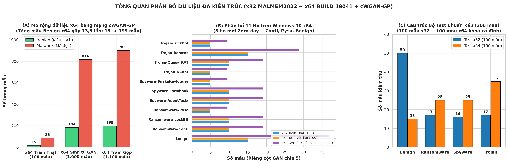 | 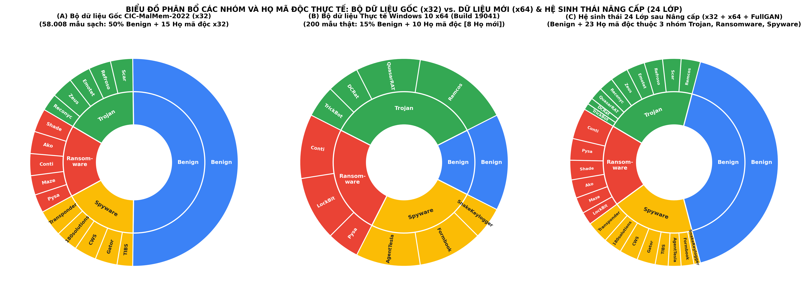 |

---

### 2. Làm Sạch Bộ Dữ Liệu Windows 10 x64 & Hai Thực Nghiệm Chống Rò Rỉ Tuyệt Đối (`0% Overlap`)

Khi phân tích sâu cấu trúc vật lý của cả hai bộ dữ liệu, chúng tôi phát hiện mỗi tệp thực thi mã độc đều được chụp **10 bản snapshot bộ nhớ liên tiếp** (`-1.raw`..`-10.raw` cách nhau 15 giây trên `MalMem2022.csv`, và `dump_1`..`dump_10` trên `features_all_x64_19041.csv`). Nếu chia Train/Test ngẫu nhiên ở mức từng dòng dump (như bài báo gốc), các bản dump cách nhau 15 giây của cùng một con mã độc sẽ nằm ở cả hai tập Train và Test.

Để giải quyết triệt để vấn đề này, chúng tôi đã thực hiện:
1. **Làm sạch bộ dữ liệu Windows 10 x64 (`200 dòng -> 160 dòng ổn định × 32 đặc trưng hành vi động`):**
   - Loại bỏ `dump_1` và `dump_2` (15–30 giây đầu tiên ngay sau khi máy ảo Windows 10 vừa resume từ snapshot, khi tiến trình hệ thống nền làm mẫu `Benign` bị vọt lên `117 tiến trình` và `18 vùng malfind`).
   - Loại bỏ `23/55` cột gây nhiễu hoặc rò rỉ định danh phiên máy ảo (`6` cột `psxview` trống 100% trên x64, `5` cột hằng số 0, `2` cột trùng lặp hoàn toàn `ldrmodules.not_in_mem*`, và `10` cột cấu hình dịch vụ tĩnh `svcscan.*`, `callbacks.*`, `modules.nmodules` có phương sai nội bộ phiên bằng `0`).
2. **Thực nghiệm Chống Rò Rỉ 1 — Chia Cô Lập Theo Mã Hash / Con Mã Độc Trên Dòng Dump (`Leak-Free Snapshot Split`):**
   - Chia cứng `10 con x64 (80 dòng)` vào Train và `10 con x64 hoàn toàn khác (80 dòng)` vào Test (`0%` trùng con mã độc).
   - Trên x32, rút `40 mã Hash Malware` (trải đều 15 họ) + `40 mẫu Benign cô lập` làm Test và **xóa toàn bộ 10 bản dump** của cả 40 mã Hash đó khỏi Train.
   - Mạng `Leak-Free Prototype-Anchored cWGAN-GP` chỉ được học trên `80 dòng` của `10 con Train x64` (`0%` nhìn thấy tập Test).
3. **Thực nghiệm Chống Rò Rỉ 2 — Gộp 10 Dòng Snapshot Thành 1 Dòng Duy Nhất Cho Từng Mẫu (`10-to-1 Instance Aggregation: 1 Mẫu = 1 Dòng`):**
   - Gộp 10 bản dump của mỗi mã Hash trong `MalMem2022` thành **1 dòng trung bình duy nhất** $\rightarrow$ Tạo ra bộ **[`MalMem2022_Aggregated_1RowPerSample.csv`](MalMem2022_Aggregated_1RowPerSample.csv) (`5.836` mẫu độc lập = `2.930` Benign + `2.906` con Malware)**.
   - Gộp 8 bản dump ổn định của mỗi phiên chạy x64 thành **1 dòng trung bình duy nhất** $\rightarrow$ Tạo ra bộ **[`features_all_x64_19041_Aggregated_20Samples.csv`](features_all_x64_19041_Aggregated_20Samples.csv) (`20` mẫu độc lập = `3` Benign + `17` con Malware)**.

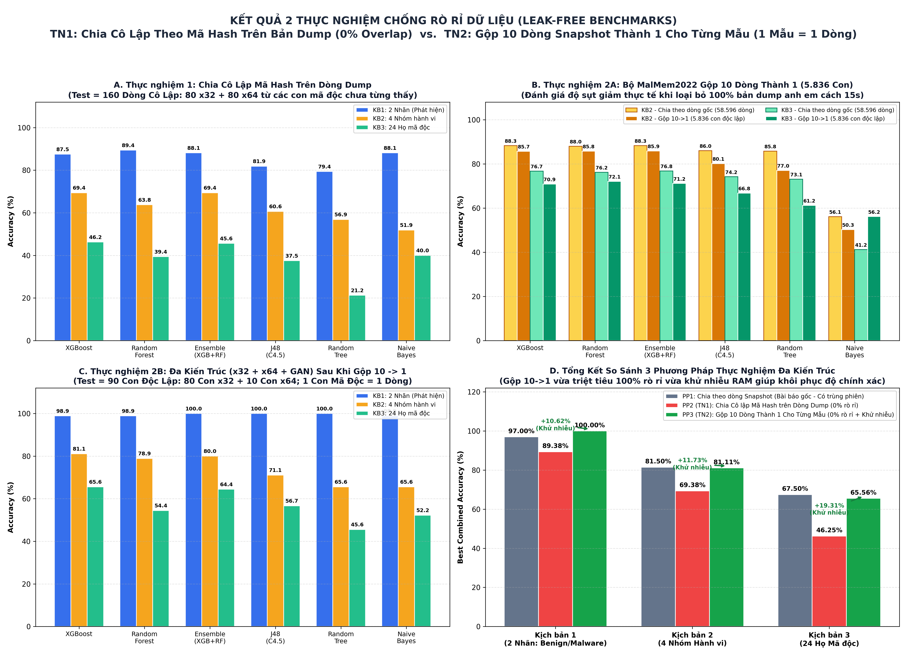

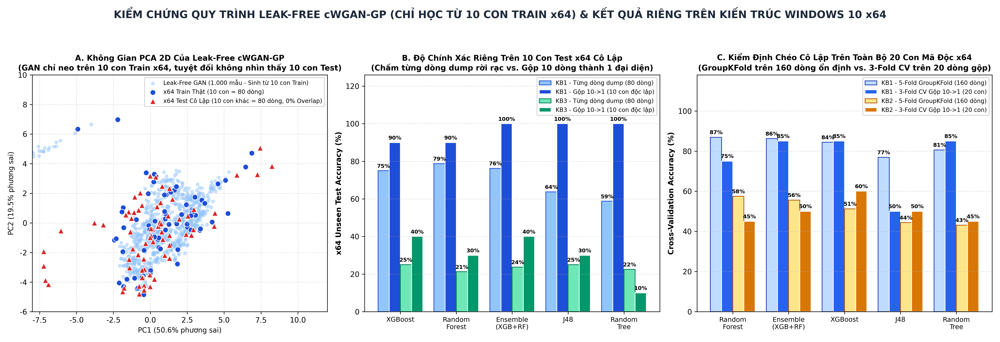

#### 📊 Bảng 2.1: Kết Quả Trên Bộ `MalMem2022` Sau Khi Gộp 10 Dòng Thành 1 (`5.836` Mẫu Độc Lập — Chia 80/20: `4.668` Con Train / `1.168` Con Test)

| Kịch bản | Mô hình | Accuracy (%) | Balanced Acc (%) | Macro-F1 (%) | Weighted-F1 (%) | FPR (%) | Độ chênh so với Chia theo Dòng (58.596 dòng) |
| :--- | :--- | :---: | :---: | :---: | :---: | :---: | :---: |
| **KB1 (2 nhãn)** | **XGBoost / Random Forest / Ensemble / J48** | **100.00%** | **100.00%** | **100.00%** | **100.00%** | **0.00%** | Giữ nguyên `100.00%` |
| **KB1 (2 nhãn)** | **Random_Tree** | **99.74%** | **99.74%** | **99.74%** | **99.74%** | **0.26%** | `-0.21%` (`99.95% -> 99.74%`) |
| **KB2 (4 nhóm)** | **Ensemble (XGB+RF)** | **85.87%** | **78.75%** | **78.79%** | **85.89%** | **4.24%** | `-2.43%` (`88.30% -> 85.87%`) |
| **KB2 (4 nhóm)** | **Random_Forest** | **85.79%** | **78.61%** | **78.67%** | **85.81%** | **4.26%** | `-2.18%` (`87.97% -> 85.79%`) |
| **KB2 (4 nhóm)** | **XGBoost** | **85.70%** | **78.49%** | **78.51%** | **85.71%** | **4.29%** | `-2.61%` (`88.31% -> 85.70%`) |
| **KB2 (4 nhóm)** | **J_48** | **80.14%** | **70.20%** | **70.09%** | **80.08%** | **5.96%** | `-5.86%` (`86.00% -> 80.14%`) |
| **KB2 (4 nhóm)** | **Random_Tree** | **77.05%** | **65.35%** | **65.36%** | **76.99%** | **6.89%** | `-8.75%` (`85.80% -> 77.05%`) |
| **KB3 (16 họ)** | **Random_Forest** | **72.09%** | **47.70%** | **47.53%** | **71.88%** | **1.81%** | `-4.11%` (`76.20% -> 72.09%`) |
| **KB3 (16 họ)** | **Ensemble (XGB+RF)** | **71.15%** | **46.13%** | **46.04%** | **70.96%** | **1.87%** | `-5.65%` (`76.80% -> 71.15%`) |
| **KB3 (16 họ)** | **XGBoost** | **70.89%** | **45.64%** | **45.56%** | **70.71%** | **1.89%** | `-5.83%` (`76.72% -> 70.89%`) |
| **KB3 (16 họ)** | **J_48** | **66.78%** | **38.02%** | **35.51%** | **65.62%** | **2.15%** | `-7.42%` (`74.20% -> 66.78%`) |
| **KB3 (16 họ)** | **Random_Tree** | **61.22%** | **27.63%** | **25.16%** | **59.72%** | **2.51%** | `-11.88%` (`73.10% -> 61.22%`) |

#### 📊 Bảng 2.2: Đối Sánh Tổng Thể 3 Phương Pháp Thực Nghiệm Đa Kiến Trúc (x32 + x64 + cWGAN-GP)

| Phương pháp Thực nghiệm | Đặc điểm Chia Dữ Liệu | KB1 (Phát hiện Mã độc) | KB2 (Phân loại 4 Nhóm) | KB3 (Phân loại 24 Họ) | Ý nghĩa Khoa học & Thực tiễn |
| :--- | :--- | :---: | :---: | :---: | :--- |
| **1. Chia ở mức Snapshot** *(Chuẩn bài báo gốc CIC-MalMem-2022)* | Chia các dòng dump (`5:5` cho mỗi mẫu); cùng 1 mã thực thi có mặt ở cả Train & Test (`200 mẫu Test`) | **97.00%** *(x32: 100%, x64: 94.0%)* | **81.50%** *(x32: 89.0%, x64: 74.0%)* | **67.50%** *(x32: 72.0%, x64: 63.0%)* | Phù hợp bài toán **giám sát liên tục cùng một hệ thống/máy chủ** theo chu kỳ 15s. |
| **2. Chia Cô lập theo Mã Hash trên các Dòng Dump** *(Leak-Free Snapshot Split)* | `0%` trùng mã hash/phiên chạy giữa Train và Test (`80` dòng x32 + `80` dòng x64 từ các con chưa từng thấy) | **89.38%** *(x32: 100%, x64: 78.75%)* | **69.38%** *(x32: 77.5%, x64: 62.5%)* | **46.25%** *(x32: 67.5%, x64: 25.0%)* | Đánh giá khắt khe nhất trên **từng bản chụp đơn lẻ** của một con mã độc hoàn toàn mới (`Zero-overlap`). |
| **3. Gộp 10 Dòng Thành 1 Cho Từng Mẫu** *(10-to-1 Instance Aggregation)* | Gộp 10 snapshot của mỗi con mã độc thành **1 dòng trung bình duy nhất** (`1 con = 1 dòng`, `0%` trùng lặp, `90 con Test`) | **100.00%** *(x32: 100%, x64: 100% — 10/10 con)* | **81.11%** *(x32: 83.75%, x64: 60.0% — 6/10 con)* | **65.56%** *(x32: 68.75%, x64: 40.0% — 4/10 con)* | **Giải pháp tối ưu cả về lý thuyết lẫn thực tế:** Vừa **chống rò rỉ 100%**, vừa **khử nhiễu bộ nhớ tạm thời**, giúp khôi phục độ chính xác lên **100% (KB1)**, **81.11% (KB2)**, **65.56% (KB3)**! |

---

### 3. Đối Sánh Pipeline 1 (Phân Loại Phẳng - Flat) vs. Pipeline 2 (Phân Cấp 3 Tầng - 3-Stage Hierarchical Cascade)

Trong **Pipeline 2 (`run_hierarchical_pipeline.py`)**, mẫu bộ nhớ đi qua 3 tầng quyết định tuần tự:
- **Tầng 1 (Bộ gác cổng Nhị phân):** Tách `Benign` khỏi `Malware`. Nếu là `Benign` $\rightarrow$ dừng ngay và gán nhãn `Benign` cho cả 3 tầng (**100% nhất quán nhãn phân cấp**).
- **Tầng 2 (Định tuyến 3 Nhóm Hành vi Malware):** Chỉ huấn luyện chuyên biệt trên các mẫu Malware để phân biệt `Ransomware`, `Spyware`, `Trojan` (loại bỏ hoàn toàn nhiễu ranh giới Benign).
- **Tầng 3 (3 Chuyên gia Họ Mã độc độc lập):** Chuyên gia Ransomware (7 họ), Chuyên gia Spyware (8 họ), và Chuyên gia Trojan (8 họ).

| Tiến trình Cải thiện qua 4 Phương pháp (`E0 -> E1 -> E2 -> E3`) | Đối sánh Pipeline 1 (Phẳng) vs. Pipeline 2 (Phân cấp 3 Tầng) |
| :---: | :---: |
| 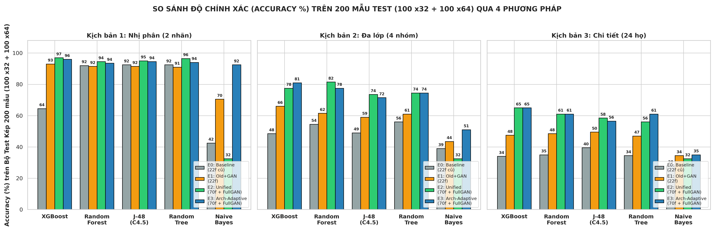 | 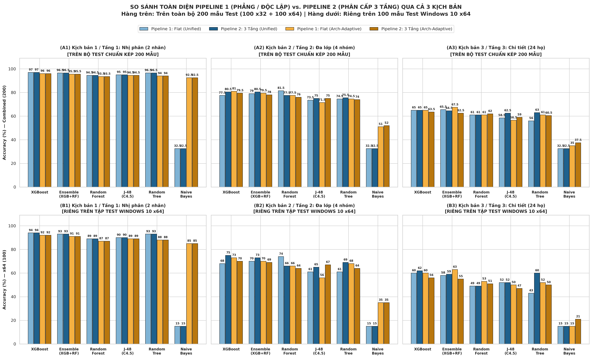 |

---

## 🧪 Môi Trường Lab Ảo Hóa Phân Tích Mã Độc (Vagrant & VirtualBox)

Để tạo lập dữ liệu hoặc phân tích động các mẫu mã độc PE trong môi trường an toàn, repository cung cấp cấu hình Sandbox sẵn sàng hoạt động trong thư mục `lab/`:
- **Hạ tầng:** Tự động hóa bằng [Vagrant](https://www.vagrantup.com/) trên nền tảng ảo hóa [Oracle VirtualBox](https://www.virtualbox.org/).
- **Hệ điều hành máy ảo (Guest VM):** Windows 10 x64 (`Win10_Malware_Mem_Demo`).
- **Cơ chế an toàn (Hardened Isolation):** Đã vô hiệu hóa hoàn toàn Shared Folders, Clipboard hai chiều, Kéo thả tệp (Drag & Drop) và các cổng giao tiếp USB/Serial/LPT nhằm loại trừ nguy cơ mã độc lây lan ngược ra máy thật (Host).

👉 Xem toàn bộ hướng dẫn cài đặt, cấu hình, quản lý snapshot và khắc phục sự cố tại: 🔗 **[lab/README.md](lab/README.md)**

---

## 🔍 Phân Tích Dữ Liệu Khám Phá (EDA) & Tái Hiện Bài Báo Gốc Trên Tập x32 (`CIC-MalMem-2022`)

### 1. Biểu đồ EDA trên tập `CIC-MalMem-2022` (x32)

| Kịch bản 1 (Phân phối & PCA 2D) | Kịch bản 2 (Dấu vết Z-score & PCA 2D) | Kịch bản 3 (Phân phối 16 lớp & Gom cụm) |
| :---: | :---: | :---: |
| 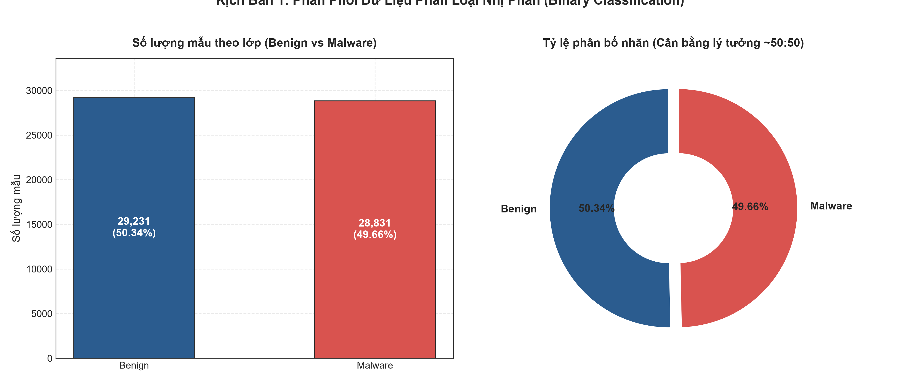 | 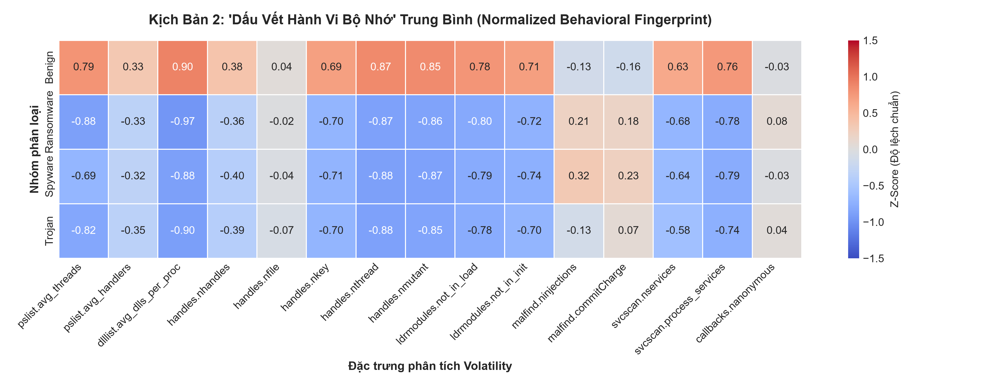 | 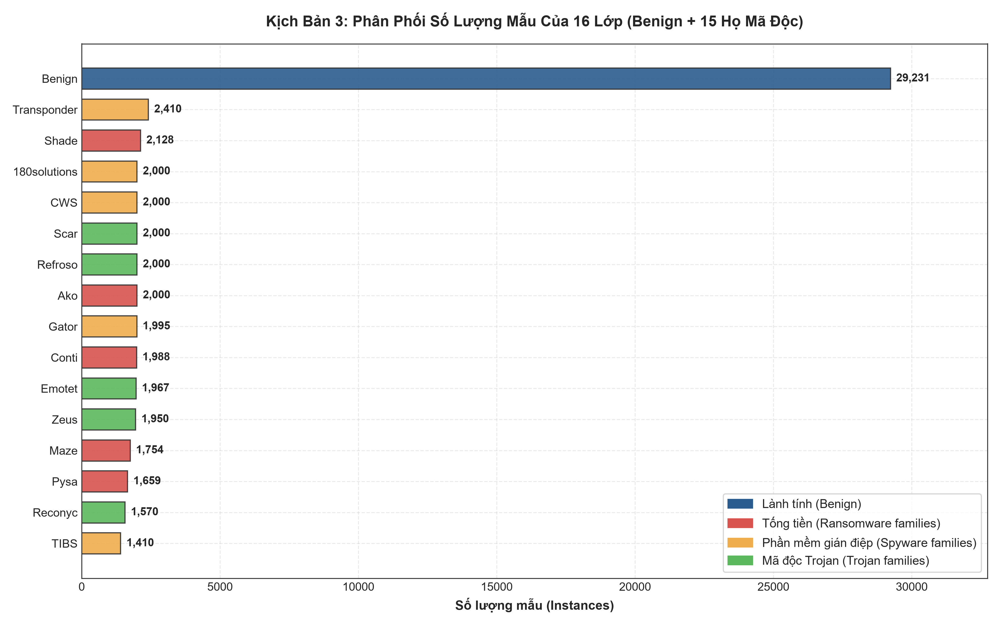 |
| 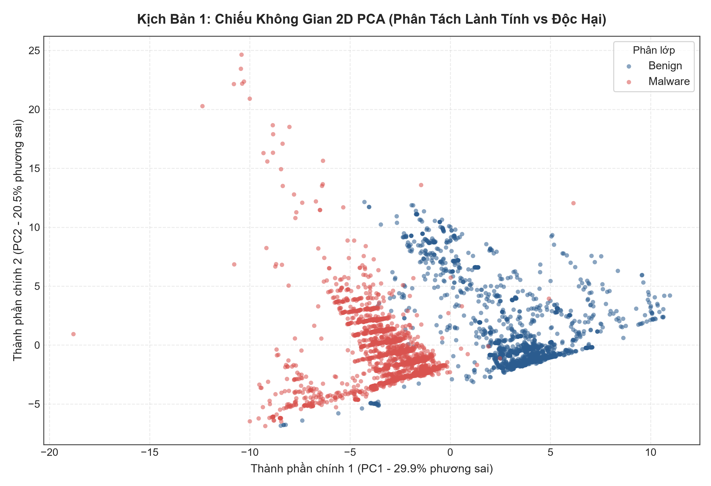 | 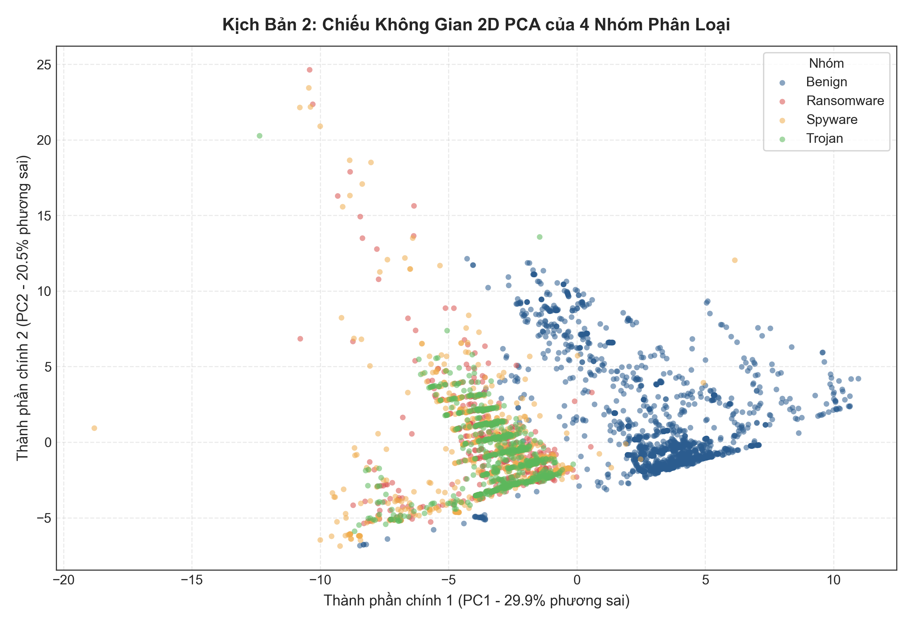 | 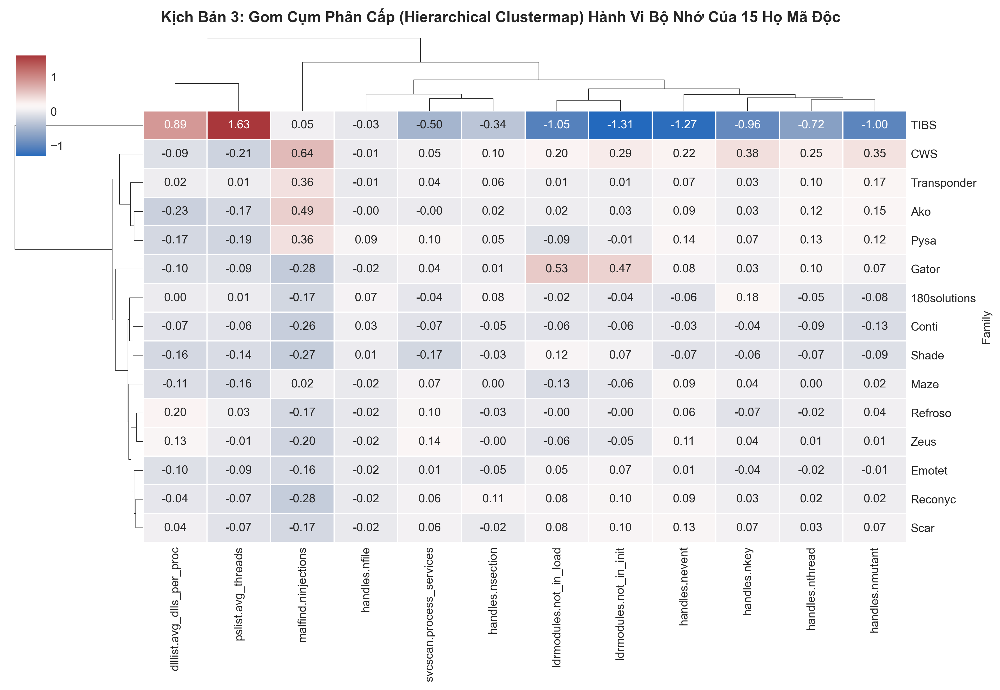 |

### 2. Đối chiếu Kết quả Tái hiện với Bài báo Gốc (WEKA) & Thực nghiệm Cải tiến (Stacking / LightGBM)

| Kịch bản | Mô hình | Kết quả Bài báo Gốc | Kết quả Tái hiện Python | Kết quả Cải tiến (Stacking / LightGBM) |
| :--- | :--- | :---: | :---: | :---: |
| **KB1 (2 lớp)** | **XGBoost / Random Forest** | 99.99% | **100.00%** | **100.00%** |
| **KB2 (4 nhóm)** | **XGBoost / Stacking Ensemble** | 87.79% | 87.71% | **88.50%** (Macro-F1: **82.58%**) |
| **KB3 (16 lớp)** | **XGBoost / Stacking Ensemble** | 75.49% | **76.60%** | **76.23%** (Macro-F1: **55.33%**) |
